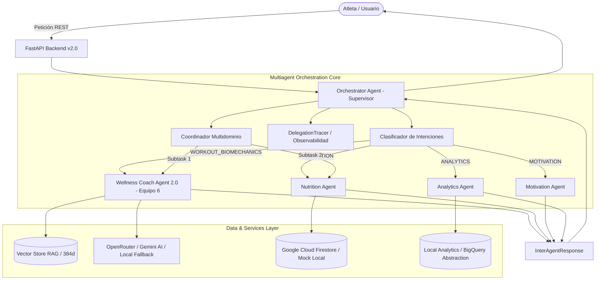

# Intelligent Wellness & Weightlifting SaaS Platform (Team 6)

[](LICENSE)
[](https://www.python.org/)
[](https://fastapi.tiangolo.com/)
[](https://reactjs.org/)
[](https://vitejs.dev/)
[](https://aws.amazon.com/)

> **Master's Program in ICT (2026-I) — Computing Laboratory Project**  
> **Team 6 Repository**: [wellness-platform-team6](https://github.com/YaskCode-laboratory/wellness-platform-team6)

---

## Vision General del Proyecto

**Wellness Lift** es una plataforma SaaS inteligente multi-sucursal y multi-rol diseñada para la gestión integral de centros de entrenamiento, entrenadores personales y atletas. Integra un **Sistema Multiagente (Supervisor Pattern)** con agentes especializados por dominio:

1. **Wellness Coach Agent 2.0 (Equipo 6):** Biomecánica del ejercicio, selección de alternativas seguras por restricciones médicas (ej. hernia discal lumbar), motor RAG con base vectorial de 384 dimensiones y ciclo de razonamiento ReAct.
2. **Nutrition Agent:** Estimación del gasto energético total (TDEE) y cálculo de macronutrientes.
3. **Motivation Agent:** Refuerzo de hábitos, disciplina y adherencia deportiva.
4. **Analytics Agent:** Telemetría de progreso, volumen acumulado (kg) y validación de sobrecarga progresiva mediante capa de analítica local / abstracción BigQuery.

---

## Arquitectura del Sistema Multiagente



---

## Guia de Inicio Rapido y Ejecucion de la Demo

### 1. Clonar el repositorio e instalar dependencias

```bash
git clone https://github.com/YaskCode-laboratory/wellness-platform-team6.git
cd wellness-platform-team6
pip install -r src/backend/requirements.txt
```

### 2. Ejecutar la Demostracion Multiagente End-to-End

```bash
python scripts/demo_multiagent.py
```
> Ejecuta 5 escenarios representativos: consulta de entrenamiento al Coach 2.0, cálculo nutricional al Nutrition Agent, refuerzo psicológico al Motivation Agent, métricas de progreso al Analytics Agent y un caso de colaboración multidominio compuesta con trazabilidad de Spans (`trace_id`).

### 3. Ejecutar la Suite de Pruebas Automatizadas

```bash
pytest tests/ -v
```

---

## Jerarquia de Roles y Credenciales de Demostracion

| Rol | Correo Electrónico | Contraseña | Permisos |
| :--- | :--- | :--- | :--- |
| **Administrador** | `admin@wellnessgym.com` | `admin123` | Control total, sucursales, alta de staff y reasignación de atletas. |
| **Entrenador (Coach)** | `coach.carlos@wellnessgym.com` | `coach123` | Edición de rutinas, revisión de solicitudes y ficha técnica de alumnos. |
| **Atleta / Cliente** | `juan@wellness.com` | `password123` | Modo Gimnasio en vivo, registro día a día y asistente IA. |

---

## Estructura del Repositorio

```
wellness-platform-team6/
├── .github/          # Workflows de CI/CD para GitHub Actions
├── data/             # Base de conocimiento RAG, chunks, vectores y resultados de evaluacion
├── docs/             # Documentacion tecnica, ADRs, guias de arquitectura y reportes
│   ├── architecture/ # Arquitectura del sistema y decisiones ADR (001 a 008)
│   ├── agents/       # Especificacion de agentes especializados y comunicacion
│   ├── evaluation/   # Evaluacion de calidad, latencia y observabilidad
│   ├── orchestration/# Especificacion del Orchestrator Supervisor
│   └── reports/      # Informes finales consolidados de Sprints 1, 2 y 3
├── prompts/          # Prompts del sistema utilizados por los agentes IA
├── scripts/          # Scripts de automatizacion, generacion de embeddings y demo multiagente
├── src/
│   ├── backend/      # [OFICIAL] API RESTful con FastAPI, RAG, ReAct y sistema multiagente
│   └── frontend/     # [OFICIAL] Aplicacion web SPA con React 18 y Vite
├── tests/            # Suite completa de pruebas unitarias y de integracion
├── .env.example      # Plantilla de variables de entorno (con placeholders ficticios)
├── CHANGELOG.md      # Registro de cambios del proyecto
├── LICENSE           # Licencia del proyecto (MIT)
└── README.md         # Documentacion principal
```

---

## Declaracion de la Estructura Oficial de Desarrollo y Despliegue

La estructura de código fuente oficial y única para el desarrollo y despliegue del proyecto se encuentra ubicada en el directorio **`src/`**:
- **Backend Oficial (`src/backend/`)**: Microservicios RESTful con FastAPI, conectores a Firestore/BigQuery, Vector Store RAG y motor de agentes IA.
- **Frontend Oficial (`src/frontend/`)**: Interfaz gráfica SPA con React 18 y Vite.

---

## Despliegue en AWS Cloud

- **Backend (FastAPI)**: Servidor Ubuntu `t3.micro` en AWS EC2 administrado por `systemd` y proxy inverso `Nginx`.
- **Frontend (React)**: AWS Amplify Hosting con canal CI/CD continuo conectado a este repositorio.

---

## Documentacion Tecnica Detallada

- [Informe Final del Sprint 3](docs/reports/sprint-3-report.md)
- [Arquitectura del Sistema Multiagente](docs/architecture/multiagent-architecture.md)
- [Especificacion del Orchestrator Agent](docs/orchestration/orchestrator-agent.md)
- [Protocolo de Comunicacion Inter-Agente](docs/agents/interagent-communication.md)
- [Evaluacion del Flujo Multiagente y Observabilidad](docs/evaluation/multiagent-evaluation.md)
- [Integracion con Firestore, BigQuery y Servicios](docs/multiagent_data_integration.md)
- [Arquitectura Tecnica del Sprint 2](docs/agent_architecture_sprint2.md)
- [Especificacion del Ciclo ReAct](docs/react_agent_architecture.md)
- [Informe de Evaluacion del Agente S2-06](docs/agent_evaluation_report.md)

---

## Licencia

Este proyecto se distribuye bajo la licencia **MIT**. Consulta el archivo `LICENSE` para más detalles.
