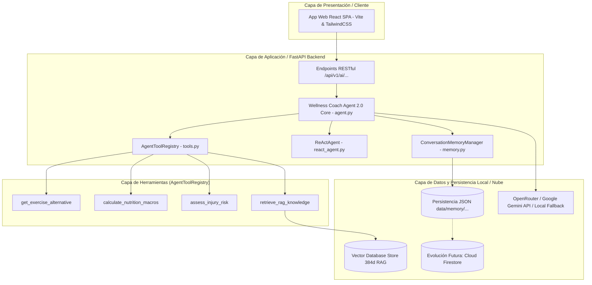
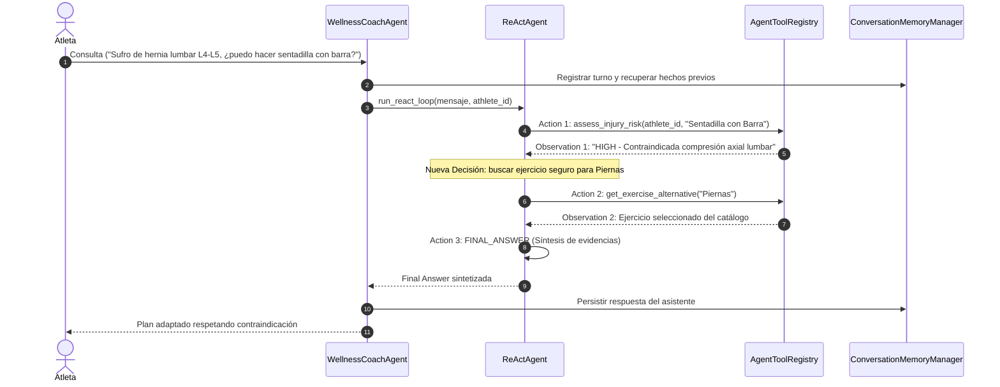

# Arquitectura Técnica y Resultados del Sprint 2 — Wellness Coach Agent 2.0 (Issue #18)

## 1. Visión General y Propósito del Agente 2.0
El **Wellness Coach Agent 2.0** es un sistema conversacional e inteligente multi-herramienta diseñado para actuar como Entrenador de Fuerza, Biomecánica y Salud Deportivo. Combina razonamiento adaptativo ReAct, memoria conversacional episódica y llamadas a herramientas (Tool Calling) para generar planes de entrenamiento seguros e hiper-personalizados.

---

## 2. Diagrama de Componentes de la Arquitectura (Mermaid)



---

## 3. Memoria Conversacional de Doble Nivel (`ConversationMemoryManager`)
1. **Memoria a Corto Plazo (Short-Term Buffer)**: Mantiene la ventana deslizante de turnos recientes (`max_history_turns * 2`) mediante `get_history()` para inyección contextual directa en el prompt del LLM.
2. **Memoria a Largo Plazo (Long-Term Persistence & Fact Extraction)**: Almacena en archivos JSON locales (`data/memory/{user_id}_memory.json`) la totalidad del historial conversacional sin truncar y extrae hechos médicos y deportivos clave (ej. *Hernia Discal L4-L5*, *Lesión de Menisco*).
3. **Evolución Futura a la Nube**: La arquitectura desacopla el almacenamiento local permitiendo migrar de forma transparente a Google Cloud Firestore (`users/{user_id}/facts`) para entornos multinodo en producción.

---

## 4. Registro Unificado de Herramientas (`AgentToolRegistry`)

El agente unifica todas sus capacidades operativas en `AgentToolRegistry` (`src/backend/app/wellness_agent/tools.py`), exponiendo esquemas formales en JSON Schema (`get_tool_schemas`) y ejecución segura con manejo de excepciones (`execute_tool`):

| Herramienta | Firma y Entradas | Propósito y Salida |
| :--- | :--- | :--- |
| `get_exercise_alternative` | `muscle_group: str` | Obtiene un ejercicio sustituto del catálogo para el grupo muscular especificado. |
| `calculate_nutrition_macros` | `user_id: str` | Calcula el TDEE y desglose de macronutrientes recomendados para el atleta. |
| `assess_injury_risk` | `user_id, exercise_name` | Evalúa el riesgo biomecánico según el perfil y la memoria de patologías del atleta. |
| `retrieve_rag_knowledge` | `query_text: str, top_k=2` | Búsqueda semántica vectorial en la base de conocimiento RAG. |

---

## 5. Patrón ReAct e Integración en el Flujo Principal

### 5.1 Ciclo de Razonamiento ReAct
`ReActAgent` implementa el flujo determinista y dinámico `Thought -> Action -> Observation -> nueva decisión -> Final Answer`:
- **Thought**: Pensamiento deliberativo formulado analizando la intención del mensaje, la memoria episódica y las observaciones acumuladas.
- **Action**: Selección de la herramienta pertinente o decisión de `FINAL_ANSWER`.
- **Observation**: Salida estructurada de la herramienta capturada e incorporada al contexto para la siguiente decisión.

### 5.2 Integración en `WellnessCoachAgent.generate_response()`
El ciclo ReAct forma parte integral del flujo principal del agente:
```python
# Flujo real en WellnessCoachAgent.generate_response()
react_result = self.react.run_react_loop(message, athlete_id=user_id)
response_text = react_result["final_answer"]
self.memory.add_message(user_id, "assistant", response_text)
```

### 5.3 Control de Iteraciones y Protección Anti-Bucle (*Anti-Loop*)
- **Límite Estricto**: Restringido a un máximo de 5 iteraciones (`max_iterations = 5`).
- **Detección de Bucles**: Se verifica la firma unívoca `action_name:json.dumps(action_input)`. Si una llamada a herramienta se repite con los mismos parámetros, se interrumpe el ciclo forzando `FINAL_ANSWER` (`loop_detected = True`).



---

## 6. Stack Tecnológico Utilizado
- **Backend**: Python 3.12, FastAPI 0.110.0, Uvicorn.
- **Modelos LLM**: OpenRouter Cloud API (Google Gemini 1.5 Pro / Flash) con soporte local determinista y sin dependencias externas obligatorias.
- **Persistencia**: Archivos JSON locales (`data/memory/{user_id}_memory.json`) con compatibilidad para Google Cloud Firestore.
- **Recuperación RAG**: Vector Database Store (Dense Similarity 384d SHA-256 + L2 Normalization / TF-IDF Baseline).
- **Pruebas y CI/CD**: Pytest 9.1.1, AnyIO, GitHub Actions.

---

## 7. Resumen Consolidado de Resultados de Evaluación del Sprint 2

Los resultados corresponden estrictamente a la ejecución final aprobada de la suite de calidad `AgentQualityEvaluator` registrada en `data/agent_evaluation_results.json` e informe `docs/agent_evaluation_report.md`:

| Métrica Evaluada | Resultado Obtenido | Criterio de Aceptación | Estado |
| :--- | :--- | :--- | :--- |
| **Casos Totales Evaluados** | `5` casos de prueba | 5 casos | **COMPLETO** |
| **Casos Aprobados (PASSED)** | `4` casos (TC-01, TC-03, TC-04, TC-05) | $\ge 4$ casos | **APROBADO** |
| **Casos Fallidos (FAILED)** | `1` caso (TC-02) | Detección rigurosa de inconsistencias | **OBJETIVO / IDENTIFICADO** |
| **Tasa de Éxito General (Accuracy)** | `80.0%` (4/5 casos) | $\ge 80.0\%$ | **APROBADO** |
| **Puntaje Promedio de Relevancia** | `4.5 / 5.0` | $\ge 4.0 / 5.0$ | **APROBADO** |
| **Prevención de Bucles Infinitos** | `0` bucles no interceptados | $0$ bucles | **APROBADO** |

### Desglose de Casos de Prueba
1. **TC-01 (Direct Knowledge Response)**: PASSED (Relevancia: 5.0/5.0). Respuesta directa sin invocar herramientas innecesarias.
2. **TC-02 (Multi-turn Conversation & Fact Retention)**: FAILED (Relevancia: 2.5/5.0). Hecho de hernia retenido y riesgo HIGH identificado; no obstante, la selección estocástica del catálogo devolvió `Sentadilla Goblet con Mancuerna`, la cual contradice la restricción axial lumbar detectada.
3. **TC-03 (ReAct Multi-step Tool Sequence)**: PASSED (Relevancia: 5.0/5.0). Secuencia ordenada `assess_injury_risk` -> `get_exercise_alternative` -> `FINAL_ANSWER`.
4. **TC-04 (Tool Calling Execution Accuracy)**: PASSED (Relevancia: 5.0/5.0). Invocación exacta de `calculate_nutrition_macros`.
5. **TC-05 (ReAct RAG Knowledge Retrieval)**: PASSED (Relevancia: 5.0/5.0). Recuperación semántica RAG y síntesis final.

---

## 8. Registros de Decisiones de Arquitectura (ADR)

### ADR-003: Estrategia de Memoria Conversacional de Doble Nivel
- **Contexto**: Necesidad de mantener fluidez en diálogos recientes sin saturar la ventana de contexto, persistiéndolos íntegramente a largo plazo.
- **Decisión**: Implementar buffer deslizante a corto plazo y guardar el historial completo en archivos JSON locales (`data/memory/{user_id}_memory.json`).
- **Consecuencia**: Carga automática en nuevas sesiones y preservación garantizada del contexto sin truncar el archivo persistido.

### ADR-004: Integración de Herramientas mediante Tool Calling y Esquemas JSON
- **Contexto**: Necesidad de unificar las capacidades de consulta del agente en un único registro mantenible y tipado.
- **Decisión**: Implementar `AgentToolRegistry` con 4 herramientas expuestas mediante formato JSON Schema (`get_tool_schemas`) y ejecutor `execute_tool()`.
- **Consecuencia**: Eliminación de registros paralelos y desacoplamiento limpio entre herramientas y razonamiento.

### ADR-005: Patrón de Razonamiento ReAct y Evaluación de Calidad
- **Contexto**: Coordinar el ciclo de decisiones multi-paso y evaluar cuantitativamente el comportamiento del agente sin falsos positivos.
- **Decisión**: Implementar `ReActAgent` con pensamientos deterministas y la suite `AgentQualityEvaluator` con criterios de exactitud estricta distinguiendo riesgo, grupo muscular y coherencia de alternativas.
- **Consecuencia**: Ejecución segura con interceptación de bucles duplicados, evaluación objetiva (80.0% de exactitud, 4.5/5.0 de relevancia) y registro formal de limitaciones biomecánicas.

---

## 9. Limitaciones Identificadas y Propuestas de Mejora

1. **Selección Estocástica de Alternativas sin Filtrado Biomecánico**:  
   - *Diagnóstico*: La herramienta `get_exercise_alternative` selecciona aleatoriamente por grupo muscular sin considerar contraindicaciones o patologías previas identificadas por `assess_injury_risk` (p. ej., sugiriendo sentadilla goblet a un usuario con hernia discal lumbar).
   - *Propuesta de Mejora*: Incorporar filtrado contextual por patologías en `get_exercise_alternative`, exclusión de alternativas contraindicadas e incorporación de restricciones biomecánicas al proceso de selección del catálogo.
2. **Latencia Acumulada**:  
   - *Diagnóstico*: El encadenamiento de múltiples herramientas secuenciales en el ciclo ReAct incrementa el tiempo de respuesta.  
   - *Propuesta de Mejora*: Implementar caché LRU de respuestas para consultas biomecánicas frecuentes.
3. **Persistencia Distribuida entre Sesiones HTTP**:  
   - *Diagnóstico*: La memoria local en archivos JSON está ligada al sistema de archivos del servidor local.  
   - *Propuesta de Mejora*: Integrar persistencia episódica en Google Cloud Firestore para mantener el historial de conversaciones de forma permanente y distribuida.
