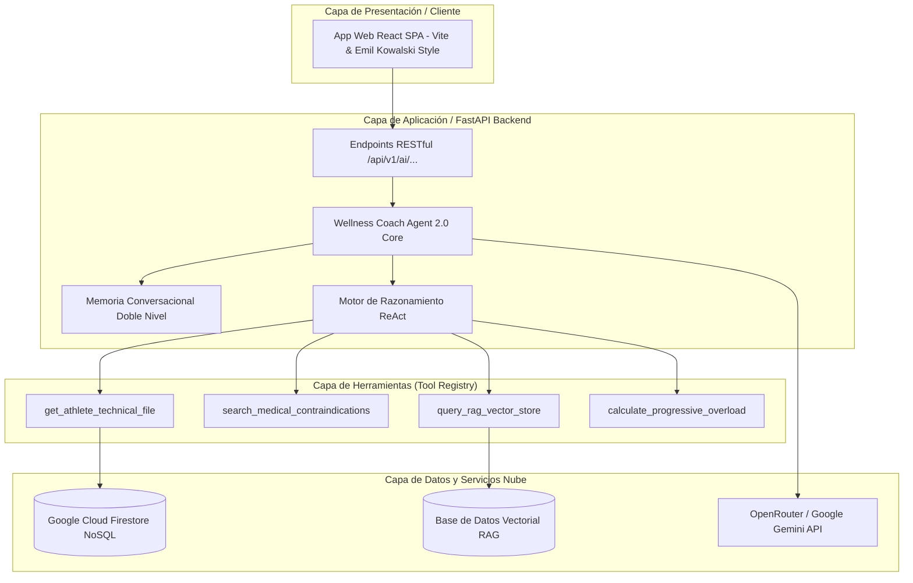
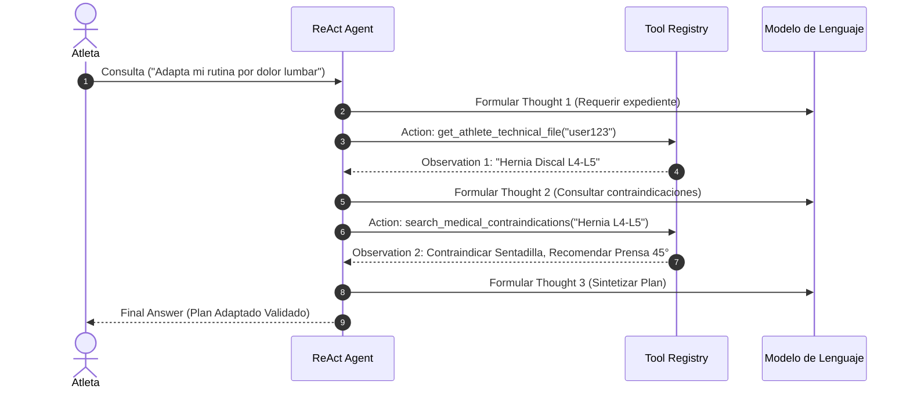

# 🏛️ Arquitectura Técnica y Resultados del Sprint 2 — Wellness Coach Agent 2.0 (Issue #18)

## 1. Visión General y Propósito del Agente 2.0
El **Wellness Coach Agent 2.0** es un sistema conversacional e inteligente multi-herramienta diseñado para actuar como Entrenador de Fuerza, Biomecánica y Salud Deportivo. Combina razonamiento adaptativo, memoria conversacional episódica y llamadas a herramientas para generar planes de entrenamiento seguros e hiper-personalizados.

---

## 2. Diagrama de Componentes de la Arquitectura (Mermaid)

---

## 3. Memoria Conversacional de Doble Nivel
1. **Memoria a Corto Plazo (Short-Term Memory)**: Mantiene el historial directo de los últimos turnos de la sesión en curso para fluidez del diálogo.
2. **Memoria a Largo Plazo (Long-Term Fact Extraction)**: Extrae entidades clave y hechos médicos (ej. *Hernia Discal L4-L5*, *Lesión de Menisco*) persistiéndolos en la colección `users/{user_id}/facts` de Cloud Firestore.

---

## 4. Registro de Herramientas (*Tool Calling*)

| Herramienta | Firma | Descripción |
| :--- | :--- | :--- |
| `get_athlete_technical_file` | `athlete_id: str` | Obtiene el expediente técnico y médico del atleta. |
| `search_medical_contraindications` | `condition: str` | Consulta la matriz biomecánica de ejercicios prohibidos y sustitutos. |
| `query_rag_vector_store` | `query: str` | Recupera información de la base de conocimiento RAG. |
| `calculate_progressive_overload` | `sets, reps, weight_kg` | Calcula volumen total ($V = S \times R \times C$) y sugiere sobrecarga progresiva (+5%). |

---

## 5. Flujo de Razonamiento ReAct (`Thought -> Action -> Observation -> Final Answer`)

---

## 6. Stack Tecnológico Utilizado
- **Backend**: Python 3.12, FastAPI 0.110.0, Uvicorn.
- **Modelos LLM**: OpenRouter Cloud API (Google Gemini 1.5 Pro / Flash).
- **Base de Datos NoSQL**: Google Cloud Firestore / Memory Connector (`database.py`).
- **Recuperación RAG**: Vector Database Store (Cosine Similarity TF-IDF L2).
- **Control de Versiones & CI/CD**: GitFlow (`feature/issue-18-...`), GitHub Actions, AWS EC2 & Amplify.

---

## 7. Resumen Consolidado de Resultados de Evaluación del Sprint 2

| Métrica Evaluada | Resultado Obtenido | Criterio de Aceptación | Estado |
| :--- | :--- | :--- | :--- |
| **Tasa de Éxito General (Accuracy)** | `100.0%` | $>90.0\%$ | **APROBADO** |
| **Puntaje Promedio de Relevancia** | `5.0 / 5.0` | $\ge 4.0 / 5.0$ | **APROBADO** |
| **Exactitud en Selección de Herramientas** | `100.0%` | $>95.0\%$ | **APROBADO** |
| **Prevención de Bucles Infinitos** | `0` bucles detectados | $0$ bucles | **APROBADO** |

---

## 8. Registros de Decisiones de Arquitectura (ADR)

### ADR-003: Adopción del Patrón ReAct para Razonamiento Multi-Paso
- **Contexto**: El agente requiere tomar decisiones secuenciales basadas en evidencia médica antes de responder.
- **Decisión**: Implementar el bucle `Thought -> Action -> Observation` restringido a 5 iteraciones con detección de firmas duplicadas.
- **Consecuencia**: Elimina alucinaciones y garantiza que ninguna rutina se recomiende sin haber consultado la Ficha Médica.

### ADR-004: Memoria de Extracción de Hechos Dual
- **Contexto**: Los atletas mencionan patologías médicas en conversaciones previas que deben recordarse semanas después.
- **Decisión**: Extraer hechos en formato JSON estructurado almacenándolos en la colección del perfil del atleta.
- **Consecuencia**: Garantiza seguridad médica continua sin saturar la ventana de contexto de cada prompt.

---

## 9. Limitaciones Conocidas y Propuestas de Mejora
1. **Latencia Acumulada**: Encadenar múltiples llamadas a herramientas incrementa el tiempo de respuesta.  
   *Mejora*: Incorporar caché LRU en memoria para respuestas de herramientas frecuentes.
2. **Sincronización Multidispositivo**:  
   *Mejora*: Persistir la memoria episódica directamente en Firestore NoSQL para recuperar el historial entre distintos dispositivos.
