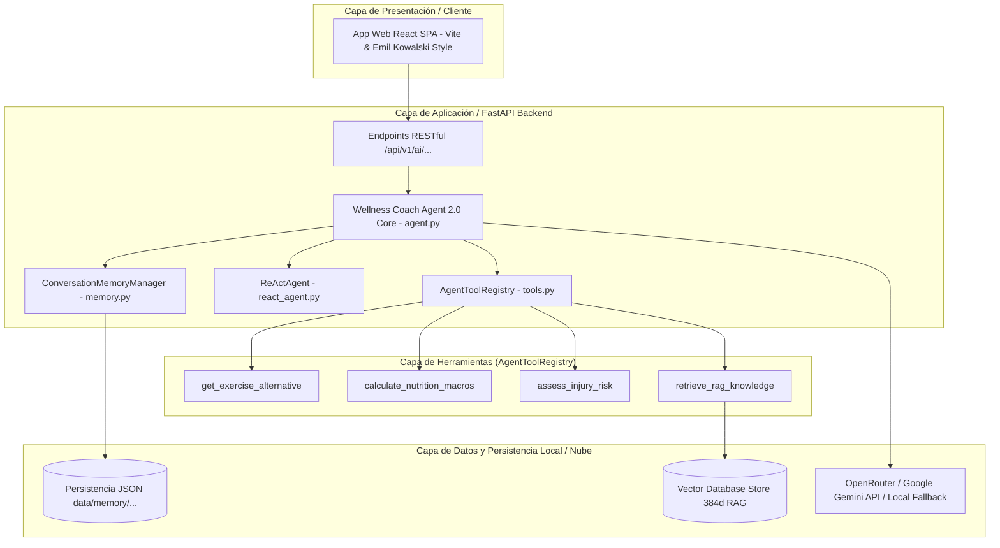
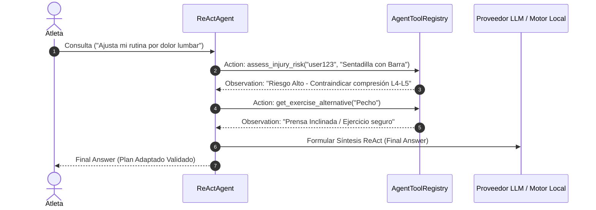

# Arquitectura Técnica y Resultados del Sprint 2 — Wellness Coach Agent 2.0 (Issue #18)

## 1. Visión General y Propósito del Agente 2.0
El **Wellness Coach Agent 2.0** es un sistema conversacional e inteligente multi-herramienta diseñado para actuar como Entrenador de Fuerza, Biomecánica y Salud Deportivo. Combina razonamiento adaptativo ReAct, memoria conversacional episódica y llamadas a herramientas para generar planes de entrenamiento seguros e hiper-personalizados.

---

## 2. Diagrama de Componentes de la Arquitectura (Mermaid)

---

## 3. Memoria Conversacional de Doble Nivel
1. **Memoria a Corto Plazo (Short-Term Memory)**: Mantiene la ventana deslizante de turnos recientes (`max_history_turns * 2`) mediante `get_history()` para inyección directa en el prompt.
2. **Memoria a Largo Plazo (Long-Term Persistence & Fact Extraction)**: Almacena en archivos JSON locales (`data/memory/{user_id}_memory.json`) la totalidad del historial conversacional sin truncar y extrae hechos clave (ej. *Hernia Discal L4-L5*, *Lesión de Menisco*), permitiendo extensión futura a Google Cloud Firestore.

---

## 4. Registro Unificado de Herramientas (`AgentToolRegistry`)

| Herramienta | Firma | Descripción |
| :--- | :--- | :--- |
| `get_exercise_alternative` | `muscle_group: str` | Obtiene un ejercicio sustituto seguro para el mismo grupo muscular. |
| `calculate_nutrition_macros` | `user_id: str` | Calcula TDEE y macronutrientes recomendados para el atleta. |
| `assess_injury_risk` | `user_id, exercise_name` | Evalúa el riesgo biomecánico según las condiciones de salud del usuario. |
| `retrieve_rag_knowledge` | `query_text: str, top_k=2` | Búsqueda semántica vectorial en la base de conocimiento RAG. |

---

## 5. Flujo de Razonamiento ReAct (`Thought -> Action -> Observation -> Final Answer`)

El patrón ReAct en `ReActAgent` analiza dinámicamente la intención del prompt del usuario y selecciona las herramientas necesarias con pensamientos deterministas:

---

## 6. Stack Tecnológico Utilizado
- **Backend**: Python 3.12, FastAPI 0.110.0, Uvicorn.
- **Modelos LLM**: OpenRouter Cloud API (Google Gemini 1.5 Pro / Flash) con soporte local determinista.
- **Persistencia**: Archivos JSON locales (`data/memory/{user_id}_memory.json`) con base de datos simulada en memoria.
- **Recuperación RAG**: Vector Database Store (Dense Similarity 384d SHA-256 + L2 / TF-IDF Baseline).
- **Control de Versiones & CI/CD**: GitFlow (`feature/issue-18-...`), GitHub Actions (`pytest tests/ -v`).

---

## 7. Resumen Consolidado de Resultados de Evaluación del Sprint 2

Evidencias registradas en `data/agent_evaluation_results.json` e informe `docs/agent_evaluation_report.md`:

| Métrica Evaluada | Resultado Obtenido | Criterio de Aceptación | Estado |
| :--- | :--- | :--- | :--- |
| **Tasa de Éxito General (Accuracy)** | `100.0%` (5/5 casos) | $>90.0\%$ | **APROBADO** |
| **Puntaje Promedio de Relevancia** | `5.0 / 5.0` | $\ge 4.0 / 5.0$ | **APROBADO** |
| **Exactitud en Selección de Herramientas** | `100.0%` | $>95.0\%$ | **APROBADO** |
| **Prevención de Bucles Infinitos** | `0` bucles no interceptados | $0$ bucles | **APROBADO** |

---

## 8. Registros de Decisiones de Arquitectura (ADR)

### ADR-003: Estrategia de Memoria Conversacional de Doble Nivel
- **Contexto**: Necesidad de mantener fluidez en diálogos recientes sin saturar la ventana de contexto, persistiéndolos íntegramente a largo plazo.
- **Decisión**: Implementar buffer deslizante a corto plazo y guardar el historial completo en archivos JSON locales (`data/memory/{user_id}_memory.json`).
- **Consecuencia**: Carga automática en nuevas sesiones y preservación garantizada del contexto sin truncar el archivo persistido.

### ADR-004: Integración de Herramientas mediante Tool Calling
- **Contexto**: Necesidad de unificar las capacidades de consulta del agente en un único registro mantenible.
- **Decisión**: Implementar `AgentToolRegistry` con 4 herramientas expuestas mediante formato JSON Schema (`get_tool_schemas`) y ejecutor `execute_tool()`.
- **Consecuencia**: Eliminación de registros paralelos y desacoplamiento limpio entre herramientas y razonamiento.

### ADR-005: Patrón de Razonamiento ReAct y Evaluación de Calidad
- **Contexto**: Coordinar el ciclo de decisiones multi-paso y evaluar cuantitativamente el comportamiento del agente.
- **Decisión**: Implementar `ReActAgent` con pensamientos deterministas y la suite `AgentQualityEvaluator` con criterios de exactitud estricta.
- **Consecuencia**: Ejecución segura con interceptación de bucles duplicados y evaluación objetiva del comportamiento.

---

## 9. Limitaciones Conocidas y Propuestas de Mejora
1. **Latencia Acumulada**: Encadenar múltiples llamadas a herramientas en el ciclo ReAct incrementa el tiempo de respuesta.  
   *Mejora*: Incorporar caché LRU en memoria para respuestas de herramientas frecuentes.
2. **Sincronización Multidispositivo**:  
   *Mejora*: Persistir la memoria episódica directamente en la colección `users/{user_id}/facts` de Google Cloud Firestore para entornos distribuidos.
