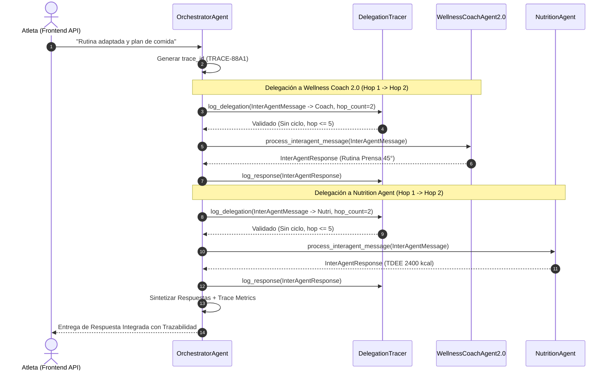

# Especificación del Protocolo de Comunicación Inter-Agente

Especificación técnica del protocolo homogéneo de intercambio de mensajes, coordinación y trazabilidad entre el **Orchestrator Agent** y los agentes especializados en **Wellness Lift** (Sprint 3 — Issue #22).

---

## 1. Estructura Homogénea de Mensajes (`InterAgentMessage`)

Todos los mensajes de delegación generados por el Orchestrator Agent o intercambiados entre componentes utilizan la estructura `InterAgentMessage`:

```json
{
  "task_id": "TASK-A1B2C3D4",
  "trace_id": "TRACE-9876FEDC",
  "source_agent": "OrchestratorAgent",
  "target_agent": "WellnessCoachAgent2.0",
  "user_id": "user123",
  "intent": "WORKOUT_BIOMECHANICS",
  "context_payload": {
    "original_message": "Tengo hernia discal, ¿qué alternativas seguras hay para piernas?",
    "message": "Tengo hernia discal, ¿qué alternativas seguras hay para piernas?",
    "user_id": "user123",
    "health_conditions": ["Hernia Discal L4-L5"],
    "limitations": "Evitar compresión lumbar brusca",
    "goal": "hipertrofia",
    "level": "intermedio",
    "extracted_facts": ["El usuario reporta dolor de espalda baja en sentadillas."]
  },
  "timestamp": 1788105000.0,
  "hop_count": 1
}
```

### Descripción de Campos:
- `task_id`: Identificador único de la sub-tarea delegada.
- `trace_id`: Identificador global de la traza para correlacionar solicitudes compuestas multi-agente.
- `source_agent`: Nombre del agente emisor (`OrchestratorAgent`, `NutritionAgent`, etc.).
- `target_agent`: Nombre del agente receptor (`WellnessCoachAgent2.0`, `NutritionAgent`, etc.).
- `user_id`: Identificador del atleta en la plataforma.
- `intent`: Intención clasificada (`WORKOUT_BIOMECHANICS`, `NUTRITION`, `MOTIVATION`, `ANALYTICS`, `MULTIDOMAIN`).
- `context_payload`: Diccionario completo con el mensaje original del usuario, perfil de salud (`health_conditions`, `limitations`), nivel, objetivo y hechos de memoria a largo plazo.
- `timestamp`: Marca de tiempo Unix de emisión.
- `hop_count`: Contador de saltos incrementado activamente entre delegaciones sucesivas para control de profundidad.

---

## 2. Estructura Homogénea de Respuesta (`InterAgentResponse`)

Los agentes especialistas reciben la estructura `InterAgentMessage` mediante el método `process_interagent_message(msg)` y responden directamente al supervisor con la estructura `InterAgentResponse`:

```json
{
  "task_id": "TASK-A1B2C3D4",
  "trace_id": "TRACE-9876FEDC",
  "source_agent": "WellnessCoachAgent2.0",
  "status": "success",
  "content": "Para la condición de hernia discal L4-L5, se recomienda sustituir la sentadilla libre por Prensa Inclinada a 45°.",
  "metadata": {
    "domain": "Biomechanics & Training",
    "in_domain": true,
    "health_conditions": ["Hernia Discal L4-L5"]
  },
  "execution_time_ms": 45.2
}
```

---

## 3. Trazabilidad y Prevención de Ciclos (`DelegationTracer`)

El componente `DelegationTracer` en `src/backend/app/wellness_agent/communication.py` gestiona la auditoría y validación de cada delegación:

1. **Detección de Ciclos Directos e Indirectos**: Revisa la cadena completa de agentes en la traza activa. Si un agente emisor o receptor ya participó previamente en la cadena (e.g. `A -> B -> A` o `A -> B -> C -> A`), la delegación se bloquea inmediatamente retornando `status: error_cycle_detected`.
2. **Propagación e Incremento de Saltos (`hop_count`)**: Cada sub-delegación incrementa `hop_count = parent_hop_count + 1`. Si un mensaje excede `max_hops=5`, es rechazado automáticamente.
3. **Validación en Flujo Multidominio**: En `handle_multidomain_delegation()`, se evalúa obligatoriamente el retorno de `log_delegation()` antes de coordinar sub-agentes, garantizando protección de trazabilidad.
4. **Auditoría por Trace ID**: Permite consultar `get_trace_history(trace_id)` para obtener el mapa cronológico completo de qué agentes intervinieron, sus saltos (`hop_count`) y tiempos de ejecución.

---

## 4. Diagrama de Secuencia de Delegación con Trazabilidad (Mermaid)


