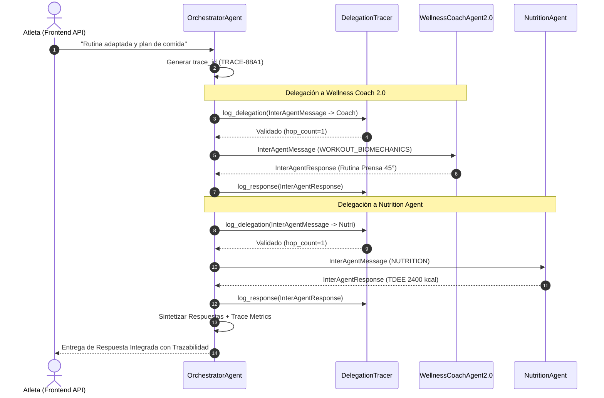

# Especificación del Protocolo de Comunicación Inter-Agente

Especificación técnica del protocolo homogéneo de intercambio de mensajes, coordinación y trazabilidad entre el **Orchestrator Agent** y los agentes especializados en **Wellness Lift** (Sprint 3 — Issue #22).

---

## 1. Estructura Homogénea de Mensajes (`InterAgentMessage`)

Todos los mensajes de delegación generados por el Orchestrator Agent o intercambiados entre componentes utilizan la estructura `InterAgentMessage`:

```json
{
  "task_id": "TASK-A1B2C3D4",
  "trace_id": "TRACE-9876FEDC",
  "source_agent": "OrchestratorAgent",
  "target_agent": "WellnessCoachAgent2.0",
  "user_id": "user_12345",
  "intent": "WORKOUT_BIOMECHANICS",
  "context_payload": {
    "message": "Tengo hernia discal, ¿qué alternativas seguras hay para piernas?"
  },
  "timestamp": 1788105000.0,
  "hop_count": 1
}
```

### Descripción de Campos:
- `task_id`: Identificador único de la sub-tarea delegada.
- `trace_id`: Identificador global de la traza para correlacionar solicitudes compuestas multi-agente.
- `source_agent`: Nombre del agente emisor.
- `target_agent`: Nombre del agente receptor.
- `user_id`: Identificador del atleta en la plataforma.
- `intent`: Intención clasificada (`WORKOUT_BIOMECHANICS`, `NUTRITION`, `MOTIVATION`, `ANALYTICS`, `MULTIDOMAIN`).
- `context_payload`: Diccionario con el mensaje original del usuario y contexto de salud/memoria.
- `timestamp`: Marca de tiempo Unix de emisión.
- `hop_count`: Contador de saltos para detección y prevención de ciclos.

---

## 2. Estructura Homogénea de Respuesta (`InterAgentResponse`)

Los agentes especialistas responden al supervisor mediante la estructura `InterAgentResponse`:

```json
{
  "task_id": "TASK-A1B2C3D4",
  "trace_id": "TRACE-9876FEDC",
  "source_agent": "WellnessCoachAgent2.0",
  "status": "success",
  "content": "Para la condición de hernia discal L4-L5, se recomienda sustituir la sentadilla libre por Prensa Inclinada a 45°.",
  "metadata": {
    "domain": "Biomechanics & Training"
  },
  "execution_time_ms": 45.2
}
```

---

## 3. Trazabilidad y Prevención de Ciclos (`DelegationTracer`)

El componente `DelegationTracer` en `src/backend/app/wellness_agent/communication.py` gestiona la auditoría de cada delegación:

1. **Detección de Bucles**: Si un mensaje intenta delegar cíclicamente al mismo origen (`A -> B -> A`), la delegación se bloquea inmediatamente retornado `status: error_cycle_detected`.
2. **Límite de Saltos (`max_hops=5`)**: Previene recursión infinita en redes multiagente compuestas.
3. **Auditoría por Trace ID**: Permite consultar `get_trace_history(trace_id)` para obtener el mapa cronológico completo de qué agentes intervinieron y sus tiempos de ejecución.

---

## 4. Diagrama de Secuencia de Delegación con Trazabilidad (Mermaid)


