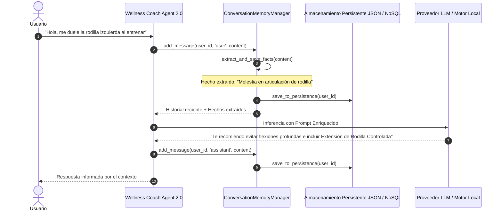

# Especificación de Memoria Conversacional (ConversationMemoryManager) — Wellness Lift

Documentación técnica del diseño, componentes, estrategia de persistencia y extracción de hechos de la **Memoria Conversacional de Doble Nivel** del Wellness Coach Agent 2.0.

---

## 1. Visión General de la Memoria de Doble Nivel

Para asegurar que el **Wellness Coach Agent 2.0** mantenga la coherencia en diálogos de múltiples turnos y recuerde información crítica del atleta sin saturar la ventana de contexto del LLM, se implementó un esquema de memoria en dos niveles:

```
                                  ┌───────────────────────────────┐
                                  │      Entrada del Usuario      │
                                  └───────────────┬───────────────┘
                                                  │
                                                  ▼
                                   ┌──────────────────────────────┐
                                   │  ConversationMemoryManager   │
                                   └──────────────┬───────────────┘
                                                  │
                         ┌────────────────────────┴────────────────────────┐
                         ▼                                                 ▼
        ┌──────────────────────────────────┐             ┌──────────────────────────────────┐
        │     Memoria a Corto Plazo        │             │      Memoria a Largo Plazo       │
        │ (Short-Term Buffer: Last 10 Turns│             │ (Persistencia JSON/NoSQL + Facts)│
        └────────────────┬─────────────────┘             └────────────────┬─────────────────┘
                         │                                                │
                         └────────────────────────┬───────────────────────┘
                                                  │
                                                  ▼
                                  ┌───────────────────────────────┐
                                  │   Inyección de Contexto en    │
                                  │          Prompt LLM           │
                                  └───────────────────────────────┘
```

1. **Memoria a Corto Plazo (Short-Term Memory Buffer)**: Mantiene los mensajes más recientes (por defecto 10 turnos pares de diálogo `user` / `assistant`). Se inyecta directamente en el prompt para mantener la fluidez de la conversación actual.
2. **Memoria a Largo Plazo (Long-Term Memory Persistence & Fact Extraction)**: Almacena en archivos JSON locales (`data/memory/{user_id}_memory.json`) la totalidad del historial de conversación sin truncar y los **Hechos Extraídos** (ej. reporte espontáneo de dolor lumbar o récords de levantamiento). La arquitectura está diseñada para permitir la extensión a Google Cloud Firestore en entornos de producción distribuidos.

---

## 2. Diagrama de Secuencia de Memoria en Mermaid



---

## 3. Estrategia de Extracción de Hechos (*Fact Extraction*)

El método `extract_and_save_facts` analiza las expresiones clave del usuario mediante expresiones regulares y reglas heurísticas de lenguaje natural:

- **Condiciones Médicas**: Detecta palabras como "hernia", "lumbar", "espalda", "rodilla", "menisco", "hombro", "manguito rotador".
- **Marcas Deportivas**: Detecta patrones como `"levanté 90 kg"` o `"mi máximo fue 100kg"`.

Los hechos extraídos se persisten y se inyectan en las generaciones futuras de rutinas semanales y respuestas conversacionales.

---

## 4. Ejemplo de Diálogo Multi-turno con Memoria

- **Turno 1**:
  - *Usuario*: "Hola, sufro de hernia discal L4-L5."
  - *Agente*: "Comprendido. He registrado tu hernia discal. Adaptaremos tu entrenamiento con prensa inclinada a 45°."
- **Turno 2**:
  - *Usuario*: "¿Qué ejercicios me recomiendas para piernas hoy?"
  - *Agente*: "(Recuerda el Turno 1) Te sugiero Prensa Inclinada y Extensión de Rodilla. Prohibida la Sentadilla Libre con Barra para proteger tu zona lumbar."
