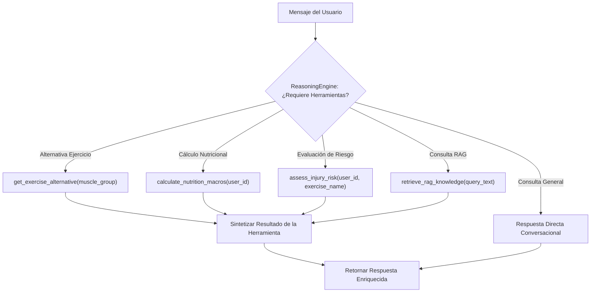

# Especificación Técnica e Integración de Herramientas (Tool Calling) — Wellness Lift

Documentación técnica del catálogo de herramientas asociadas, declaraciones formales JSON Schema y flujo de ejecución para el **Wellness Coach Agent 2.0**.

---

## 1. Visión General del Registro de Herramientas

El módulo `AgentToolRegistry` ubicado en [`src/backend/app/wellness_agent/tools.py`](file:///C:/Users/Alejandro/.gemini/antigravity/scratch/wellness-platform-team6/src/backend/app/wellness_agent/tools.py) proporciona capacidades de ejecución de herramientas (*Tool Calling / Function Calling*).



---

## 2. Declaraciones Formales de Herramientas (JSON Schema)

```json
[
  {
    "name": "get_exercise_alternative",
    "description": "Obtiene un ejercicio sustituto seguro para el mismo grupo muscular si una máquina está ocupada.",
    "parameters": {
      "type": "object",
      "properties": {
        "muscle_group": {
          "type": "string",
          "description": "Grupo muscular objetivo (ej. Pecho, Espalda, Piernas, Hombros, Bíceps, Tríceps)"
        }
      },
      "required": ["muscle_group"]
    }
  },
  {
    "name": "calculate_nutrition_macros",
    "description": "Calcula el TDEE y desglose de macronutrientes recomendados para el atleta.",
    "parameters": {
      "type": "object",
      "properties": {
        "user_id": {
          "type": "string",
          "description": "Identificador del usuario en la plataforma"
        }
      },
      "required": ["user_id"]
    }
  },
  {
    "name": "assess_injury_risk",
    "description": "Evalúa el riesgo biomecánico de un ejercicio según las condiciones de salud del usuario.",
    "parameters": {
      "type": "object",
      "properties": {
        "user_id": {
          "type": "string",
          "description": "Identificador del usuario"
        },
        "exercise_name": {
          "type": "string",
          "description": "Nombre del ejercicio a evaluar (ej. Sentadilla con Barra, Press Militar)"
        }
      },
      "required": ["user_id", "exercise_name"]
    }
  },
  {
    "name": "retrieve_rag_knowledge",
    "description": "Realiza búsqueda semántica vectorial en la base de conocimiento RAG de fisioterapia y periodización.",
    "parameters": {
      "type": "object",
      "properties": {
        "query_text": {
          "type": "string",
          "description": "Consulta o duda técnica biomecánica a buscar en el Vector Store"
        },
        "top_k": {
          "type": "integer",
          "description": "Cantidad de fragmentos más relevantes a recuperar (default: 2)"
        }
      },
      "required": ["query_text"]
    }
  }
]
```

---

## 3. Gestión de Errores y Estrategia de Fallback

Cuando una herramienta se ejecuta con parámetros no válidos o falla por conectividad:
1. El método `execute_tool` captura la excepción sin interrumpir el servidor FastAPI.
2. Devuelve una estructura JSON con `"status": "error"` y `"message": "descripción del fallo"`.
3. El motor de razonamiento captura la respuesta de error y entrega una recomendación de seguridad genérica.
