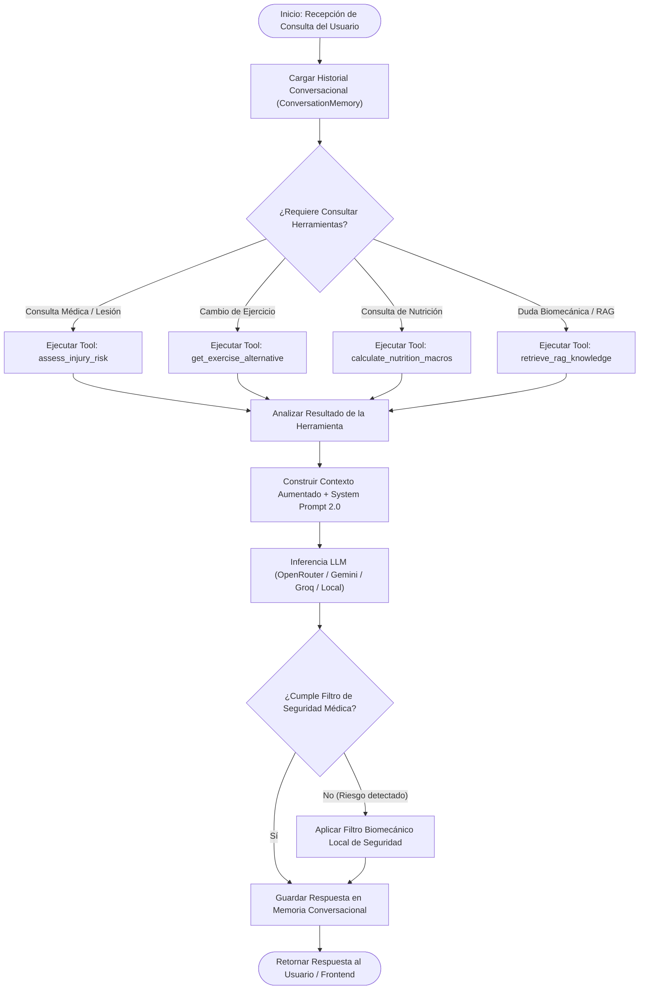
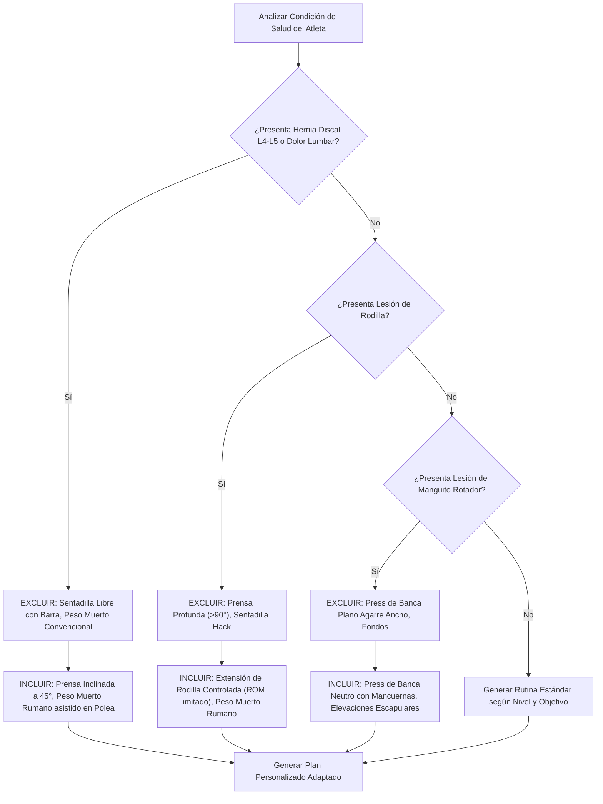

# Diseño Arquitectónico del Wellness Coach Agent 2.0 — Wellness Lift

Documentación técnica integral del diseño, responsabilidades, herramientas, prompts y flujo de razonamiento para el **Wellness Coach Agent 2.0** (Sprint 2).

---

## 1. Propósito y Alcance del Agente

El **Wellness Coach Agent 2.0** es el componente central de Inteligencia Artificial de la plataforma **Wellness Lift**. Su propósito es actuar como un entrenador deportivo personal de élite y consultor en fisioterapia biomecánica. 

Su alcance abarca:
- Generación autorregulada de rutinas de entrenamiento semanales.
- Adaptación dinámica de ejercicios ante condiciones de salud o lesiones biomecánicas preexistentes.
- Respuesta a consultas conversacionales con soporte de memoria multi-turno.
- Evaluación de riesgos biomecánicos y recomendación de macronutrientes.
- Recuperación de conocimiento científico mediante el motor RAG.

---

## 2. Delimitación de Responsabilidades

| Responsabilidad | Incluido en el Alcance (IN) | Fuera del Alcance (OUT) |
| :--- | :--- | :--- |
| **Prescripción de Ejercicios** | Selección de volumen, series, repeticiones y descansos adaptados al nivel del atleta. | Diagnóstico médico formal de patologías clínicas graves. |
| **Adaptación por Lesión** | Filtrado estricto de ejercicios contraindicados y propuesta de sustitutos biomecánicos seguros. | Tratamiento de rehabilitación kinesiológica presencial. |
| **Nutrición Deportiva** | Cálculo de TDEE y distribución recomendada de macronutrientes (Proteínas, Carbohidratos, Grasas). | Prescripción de planes dietarios farmacológicos o de patologías metabólicas. |
| **Recuperación de Evidencia** | Recuperación de artículos y guías desde el Vector Store RAG. | Generación de afirmaciones sin fundamentación en la base de conocimiento. |

---

## 3. Entradas, Salidas y Fuentes de Información

```
                       ┌─────────────────────────────────────────┐
                       │           Perfil del Atleta             │
                       │ (Nivel, Objetivo, Edad, Peso, Lesiones) │
                       └────────────────────┬────────────────────┘
                                            │
                                            ▼
┌───────────────────────────┐  ┌──────────────────────────┐  ┌───────────────────────────┐
│     Historial de Chat     │  │   Wellness Coach Agent   │  │   Vector Store RAG / API  │
│ (Memory Store Multi-turno)├──►│           2.0            │◄─┤ (Embeddings & Conocimiento)│
└───────────────────────────┘  └────────────┬─────────────┘  └───────────────────────────┘
                                            │
                                            ▼
                       ┌─────────────────────────────────────────┐
                       │          Salidas Estructuradas          │
                       │ (Rutina Semanal JSON / Respuesta Chat)  │
                       └─────────────────────────────────────────┘
```

- **Entradas**: Mensaje del usuario, historial conversacional, perfil fitness (nivel, objetivo, lesiones), métricas físicas (peso, edad), perfil nutricional (TDEE).
- **Fuentes de Información**: Google Cloud Firestore (Datos del atleta), `data/vector_store/embeddings.json` (Base vectorial RAG), `EXERCISE_CATALOG` (Catálogo de ejercicios).
- **Salidas**: JSON con cronograma semanal de ejercicios o texto formateado de respuesta conversacional.

---

## 4. Diagramas de Flujo de Razonamiento en Mermaid

### A. Ciclo de Razonamiento ReAct y Selección de Herramientas (*Tool Calling*)



---

### B. Árbol de Decisión para Adaptación de Lesiones Lumbar y Articular



---

## 5. Matriz de Herramientas Asociadas (*Tool Calling*)

| Nombre de la Herramienta | Firma / Parámetros | Propósito y Justificación |
| :--- | :--- | :--- |
| `get_exercise_alternative` | `muscle_group: str` | Selecciona un ejercicio alternativo del catálogo para sustituir máquinas ocupadas o no disponibles. |
| `calculate_nutrition_macros` | `user_id: str` | Calcula y desglosa el TDEE y macronutrientes recomendados según perfil. |
| `assess_injury_risk` | `user_id: str, exercise_name: str` | Evalúa si un ejercicio específico genera impacto articular contraindicado para el perfil del usuario. |
| `retrieve_rag_knowledge` | `query_text: str, top_k: int` | Recupera los fragmentos de evidencia científica más relevantes desde la base vectorial. |

---

## 6. Integración con la Arquitectura Existente

El diseño del **Wellness Coach Agent 2.0** se integra directamente con el paquete `src/backend/app/wellness_agent/`, manteniendo la compatibilidad con el servidor FastAPI en `src/backend/app/main.py` a través de la fachada `agent.py`.
