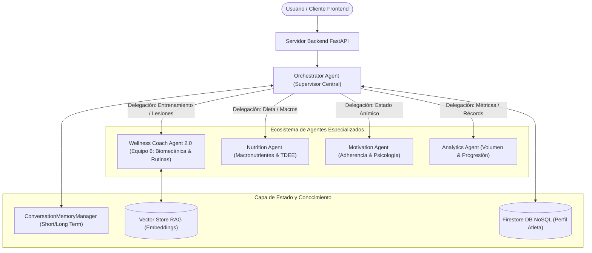
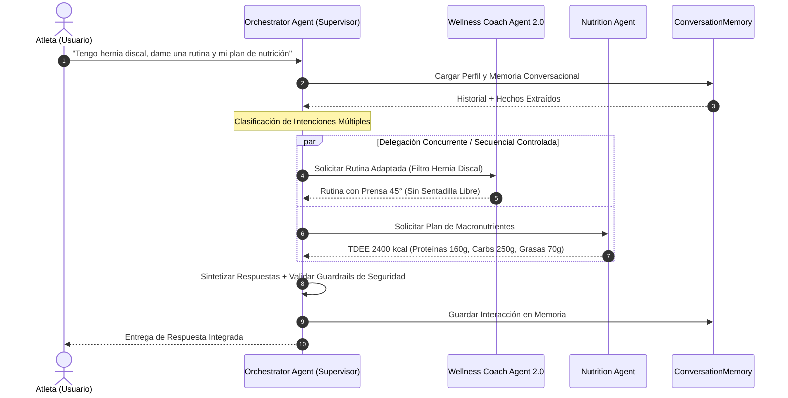
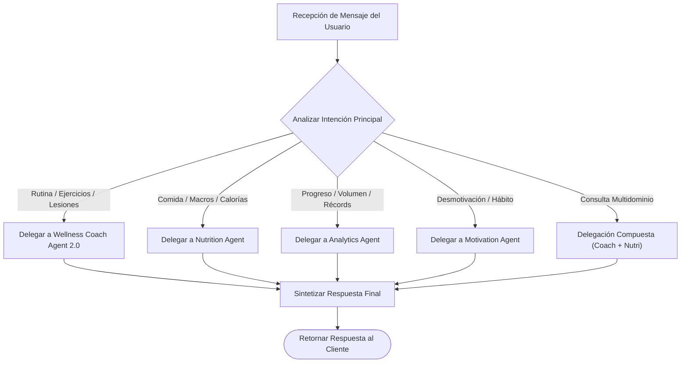

# Diseño de la Arquitectura Multiagente de Wellness Lift

Documentación técnica formal del diseño, responsabilidades, mecanismos de delegación y patrón de orquestación para el ecosistema multiagente de la plataforma **Wellness Lift** (Sprint 3).

---

## 1. Propósito y Evolución del Sistema Multiagente

La evolución de **Wellness Lift** hacia una arquitectura multiagente responde a la necesidad de resolver tareas complejas y multidominio (entrenamiento adaptativo, nutrición personalizada, soporte psicológico/motivacional y analítica de rendimiento) mediante agentes autónomos especializados.

En lugar de concentrar toda la lógica en una entidad monolítica, el sistema se estructura bajo una topología coordinada donde un **Orchestrator Agent** clasifica las intenciones del usuario, delega sub-tareas a agentes expertos y sintetiza una respuesta unificada.

---

## 2. Mapa de Agentes y Responsabilidades

| Agente | Tipo / Rol | Responsabilidades Principales | Integración / Herramientas |
| :--- | :--- | :--- | :--- |
| **Orchestrator Agent** | Supervisor / Enrutador Central | Clasificación de intenciones, ruteo de solicitudes, agregación de resultados y control de seguridad global. | `ConversationMemoryManager`, `LLMProviderManager` |
| **Wellness Coach Agent 2.0** | Agente Especializado (Equipo 6) | Prescripción de rutinas semanales, filtros de seguridad biomecánica ante lesiones, alternativas de ejercicios. | `get_exercise_alternative`, `assess_injury_risk`, RAG Vector Store |
| **Nutrition Agent** | Agente Especializado | Planificación de menús alimentarios, cálculo de TDEE y ajuste de distribución de macronutrientes. | `calculate_nutrition_macros`, Catálogo Nutricional |
| **Motivation Agent** | Agente Especializado | Análisis de sentimiento, refuerzo psicológico positivo, estrategias de formación de hábitos. | Registro de Adherencia, Sentiment Analyzer |
| **Analytics Agent** | Agente Especializado | Análisis de progresiones de carga, cálculo de volumen acumulado y proyecciones de rendimiento. | Base de Sesiones Firestore, Volume Calculator |

---

## 3. Justificación del Patrón de Orquestación: Supervisor / Jerárquico

Se evaluaron cuatro patrones principales de arquitectura multiagente:

1. **Supervisor / Jerárquico (SELECCIONADO)**: Un agente supervisor centralizado (Orchestrator Agent) coordina y delega tareas a los agentes especializados, evaluando los resultados antes de responder al usuario.
2. **Sequential (Secuencial)**: Los agentes ejecutan en una cadena rígida paso a paso. Se descartó por rigidez y latencia acumulada innecesaria en consultas simples.
3. **Hierarchical (Jerárquico Multinivel)**: Árboles profundos de supervisores. Se descartó por complejidad excesiva para el dominio actual.
4. **Swarm (Enjambre Autónomo)**: Comunicación libre entre agentes sin supervisor. Se descartó por falta de determinismo y riesgo de romper guardrails de seguridad médica.

### Justificación Técnica de la Selección:
- **Control Centralizado de Seguridad**: El Orchestrator Agent garantiza que las reglas de salud (ej. hernia discal, dolor de rodilla) se apliquen estrictamente antes de retornar cualquier recomendación al atleta.
- **Eficiencia en Invocación**: Permite invocar únicamente a los agentes especializados requeridos por la consulta actual, reduciendo el consumo de tokens y el tiempo de respuesta.
- **Gestión de Memoria Unificada**: La memoria conversacional multi-turno se gestiona de forma transparente a nivel del supervisor.

---

## 4. Diagramas Arquitectónicos en Mermaid

### A. Diagrama General de la Arquitectura Multiagente



---

### B. Diagrama de Secuencia de Orquestación y Delegación



---

### C. Árbol de Decisión de Ruteo del Supervisor



---

## 5. Protocolo de Comunicación Inter-Agente (Payload Schema)

Las solicitudes delegadas por el **Orchestrator Agent** hacia los agentes especializados utilizan una estructura JSON homogénea:

```json
{
  "task_id": "TASK-2026-0830-01",
  "source_agent": "OrchestratorAgent",
  "target_agent": "WellnessCoachAgent2.0",
  "user_id": "user_12345",
  "intent": "generate_routine_with_medical_guardrails",
  "payload": {
    "fitness_level": "intermedio",
    "goal": "hipertrofia",
    "health_conditions": ["hernia discal L4-L5"],
    "extracted_facts": ["Condición reportada en chat: Dolor lumbar."]
  }
}
```

---

## 6. Conclusión y Coherencia con el Sistema

La arquitectura propuesta evoluciona de manera natural los desarrollos de los Sprints 1 y 2, posicionando al **Wellness Coach Agent 2.0** como el agente experto en ciencia del ejercicio y preservando la retrocompatibilidad con la API FastAPI existente.
