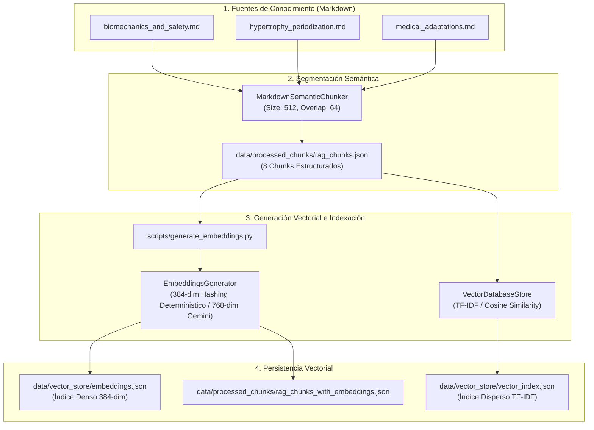
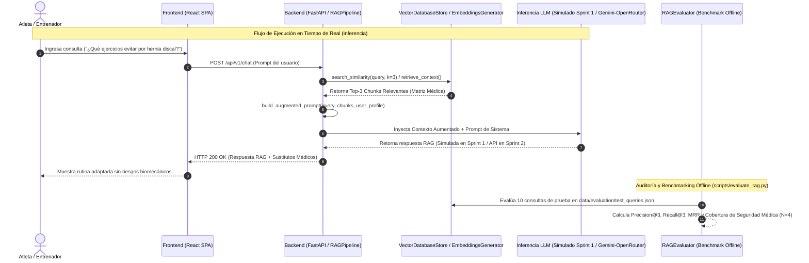

# 🏛️ Arquitectura del Sistema RAG — Wellness Lift

Documentación técnica integral de la arquitectura, componentes, decisiones de diseño, flujo de datos y resultados del sistema de **Recuperación Aumentada por Generación (RAG)** de **Wellness Lift** (Sprint 1).

---

## 📌 1. Visión General del Sistema RAG

El motor RAG de **Wellness Lift** tiene como objetivo enriquecer las respuestas de los agentes de Inteligencia Artificial con evidencia científica fundamentada en biomecánica, periodización del entrenamiento deportivo y matrices de seguridad/adaptaciones médicas ante lesiones físicas.

```text
                                ┌─────────────────────────┐
                                │   AWS Amplify (HTTPS)   │
                                │  Frontend React Vite    │
                                └────────────┬────────────┘
                                             │ HTTP / JSON API
                                             ▼
                                ┌─────────────────────────┐
                                │     AWS EC2 (Ubuntu)    │
                                │  Nginx Reverse Proxy    │
                                │    FastAPI Backend      │
                                └────────────┬────────────┘
                                             │
                      ┌──────────────────────┴──────────────────────┐
                      ▼                                             ▼
        ┌───────────────────────────┐                 ┌───────────────────────────┐
        │   Google Cloud Firestore  │                 │ OpenRouter / Gemini API   │
        │    Base de Datos NoSQL    │                 │   Motor de Agentes de IA  │
        └───────────────────────────┘                 └───────────────────────────┘
```

---

## 📐 2. Diagramas de Arquitectura y Flujo de Datos

### A. Pipeline de Ingesta, Chunking e Indexación Vectorial



---

### B. Flujo en Tiempo de Ejecución (Búsqueda, Aumento de Prompt y Generación)



---

## 🧩 3. Componentes Principales del Sistema

| Componente | Archivo Fuente | Descripción y Responsabilidad |
| :--- | :--- | :--- |
| **`MarkdownSemanticChunker`** | [`src/backend/app/rag_chunker.py`](../../src/backend/app/rag_chunker.py) | Segmentador semántico de documentos Markdown respetando jerarquía de encabezados (`#`, `##`, `###`) con ventana deslizante (512 tokens objetivo, 64 tokens de solapamiento). |
| **`EmbeddingsGenerator`** | [`src/backend/app/embeddings_generator.py`](../../src/backend/app/embeddings_generator.py) | Generador vectorial determinista de **384 dimensiones** basado en hashing semántico normalizado $L2$ (`zlib.adler32`) para entornos offline/CI-CD (etiquetado como `sentence-transformers/all-MiniLM-L6-v2`), con soporte para `text-embedding-004` (**768 dimensiones**) mediante Gemini API. |
| **`VectorDatabaseStore`** | [`src/backend/app/vector_store.py`](../../src/backend/app/vector_store.py) | Motor de almacenamiento vectorial e indexación liviana basado en ponderación TF-IDF y similitud coseno persisido en `data/vector_store/vector_index.json`. |
| **`RAGPipeline`** | [`src/backend/app/rag_pipeline.py`](../../src/backend/app/rag_pipeline.py) | Orquestador End-to-End en tiempo de ejecución. Realiza la búsqueda vectorial por similitud, construye el prompt aumentado (`build_augmented_prompt`) y ejecuta la inferencia de respuesta (con mecanismo simulado/fallback en Sprint 1 y compatibilidad API Cloud para Sprint 2). |
| **`RAGEvaluator`** | [`src/backend/app/rag_evaluator.py`](../../src/backend/app/rag_evaluator.py) | Suite de benchmarking offline independientemente ejecutable (`scripts/evaluate_rag.py`). Evalúa **Precision@K**, **Recall@K**, **MRR** y audita la **Cobertura de Seguridad Médica** en los chunks recuperados. |
| **`WellnessCoachAgent`** | [`src/backend/app/agent.py`](../../src/backend/app/agent.py) | Agente orquestador de Inteligencia Artificial que recibe el contexto RAG y genera respuestas y rutinas adaptadas. |

---

## 🛠️ 4. Aclaraciones de Implementación Efectiva en Sprint 1

> [!NOTE]
> **Generador de Embeddings Local**: La implementación de `EmbeddingsGenerator` en el entorno local/offline utiliza un algoritmo determinista basado en hashing de n-gramas con normalización $L2$ (384 float). Aunque lleva la etiqueta de modelo `sentence-transformers/all-MiniLM-L6-v2` para mantener compatibilidad dimensional y metadatos, no realiza inferencia neuronal pesada de PyTorch en entorno local. En producción con `GEMINI_API_KEY`, utiliza el modelo denso `text-embedding-004` de Google Gemini (768 float).

> [!NOTE]
> **Inferencia LLM en Sprint 1**: El componente `RAGPipeline` construye el prompt aumentado completo para el LLM. Durante el Sprint 1, la generación final se realiza a través de `_generate_simulated_llm_response()` como mecanismo fallback determinista para demostración e integración local sin costo de API, manteniendo la compatibilidad de interfaz con Gemini API y OpenRouter para el Sprint 2.

---

## 📊 5. Resultados del Benchmark Reproducible (S1-06)

Basado en la ejecución reproducible del script de evaluación `scripts/evaluate_rag.py` sobre `data/evaluation/test_queries.json`:

- **Precision@3 Promedio**: **30.00%** (0.3000)
- **Recall@3 Promedio**: **90.00%** (0.9000 — 9 de 10 consultas recuperaron sus chunks esperados en Top-3)
- **Mean Reciprocal Rank (MRR)**: **0.7000** (El chunk relevante se ubica prioritariamente en la primera o segunda posición)
- **Precisión en Seguridad Médica (Cobertura en Chunks)**: **100.00%** (4 de 4 casos médicos $N_{medical}=4$ recuperaron tanto las contraindicaciones como los sustitutos seguros)

---

## ⚠️ 6. Limitaciones Conocidas y Roadmap para Sprint 2

1. **Granularidad de Chunks Médicos**:
   - *Limitación*: Toda la matriz de sustitución médica se encuentra en un solo chunk.
   - *Mejora Sprint 2*: Dividir la matriz en sub-chunks por patología clínica específica.
2. **Estrategia de Búsqueda Híbrida**:
   - *Limitación*: Términos muy específicos aislados (ej. "RIR") requieren ponderación léxica.
   - *Mejora Sprint 2*: Implementar combinación híbrida Sparse (BM25) + Dense (Coseno).
