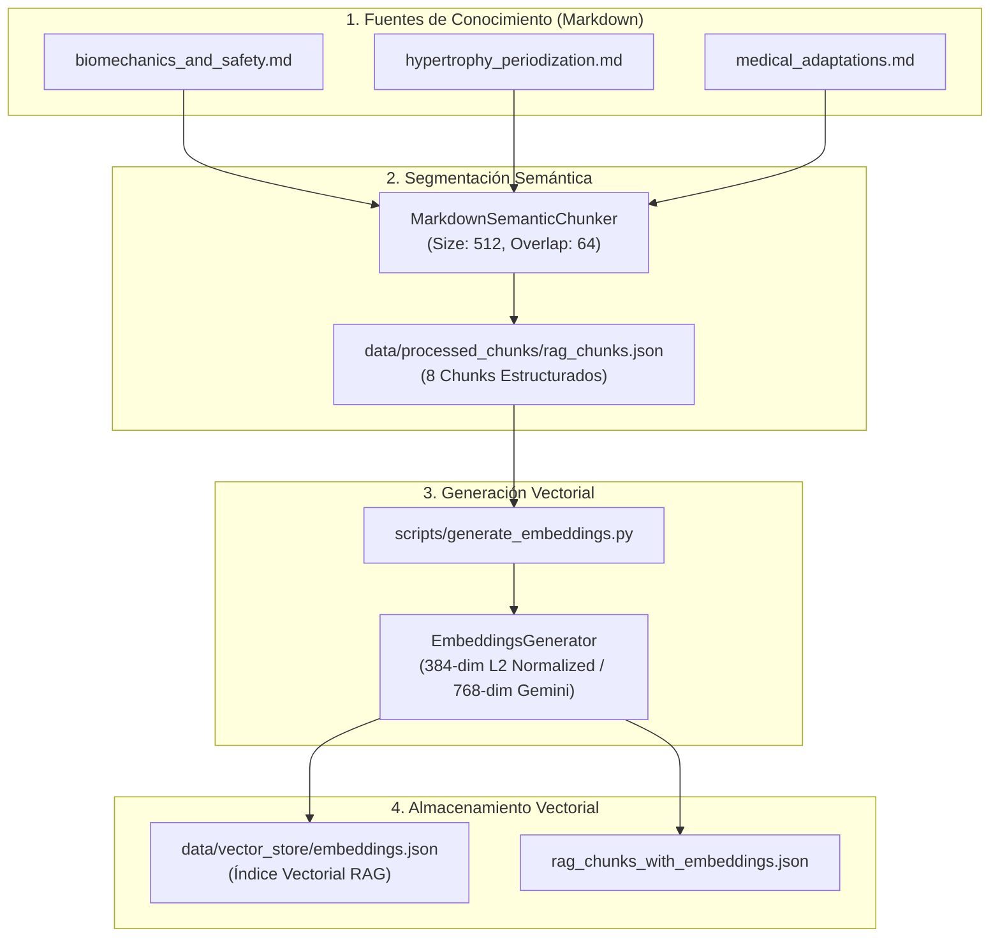
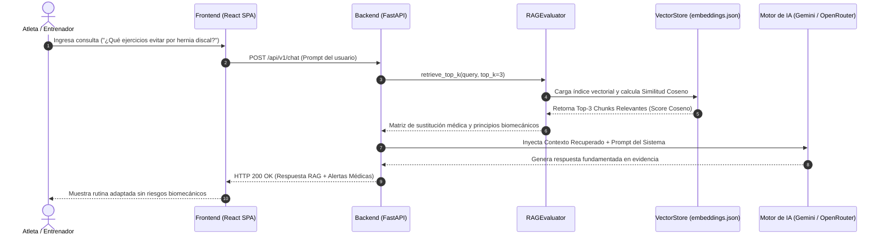

# 🏛️ Arquitectura del Sistema RAG — Wellness Lift

Documentación técnica integral de la arquitectura, componentes, decisiones de diseño, flujo de datos y resultados del sistema de **Recuperación Aumentada por Generación (RAG)** de **Wellness Lift** (Sprint 1).

---

## 📌 1. Visión General del Sistema RAG

El motor RAG de **Wellness Lift** tiene como objetivo enriquecer las respuestas de los agentes de Inteligencia Artificial con evidencia científica fundamentada en biomecánica, periodización del entrenamiento deportivo y matrices de seguridad/adaptaciones médicas ante lesiones físicas.

```
                                ┌─────────────────────────┐
                                │   AWS Amplify (HTTPS)   │
                                │  Frontend React Vite    │
                                └────────────┬────────────┘
                                             │ HTTP / JSON API
                                             ▼
                                ┌─────────────────────────┐
                                │     AWS EC2 (Ubuntu)    │
                                │  Nginx Reverse Proxy    │
                                │    FastAPI Backend      │
                                └────────────┬────────────┘
                                             │
                      ┌──────────────────────┴──────────────────────┐
                      ▼                                             ▼
        ┌───────────────────────────┐                 ┌───────────────────────────┐
        │   Google Cloud Firestore  │                 │ OpenRouter / Gemini API   │
        │    Base de Datos NoSQL    │                 │   Motor de Agentes de IA  │
        └───────────────────────────┘                 └───────────────────────────┘
```

---

## 📐 2. Diagramas de Arquitectura y Flujo de Datos

### A. Pipeline de Ingesta, Chunking e Indexación Vectorial



---

### B. Flujo en Tiempo de Ejecución (Búsqueda y Generación Aumentada)



---

## 🧩 3. Componentes Principales del Sistema

| Componente | Archivo Fuente | Descripción y Responsabilidad |
| :--- | :--- | :--- |
| **`MarkdownSemanticChunker`** | [`src/backend/app/rag_chunker.py`](file:///C:/Users/Alejandro/.gemini/antigravity/scratch/wellness-platform-team6/src/backend/app/rag_chunker.py) | Segmentador semántico de documentos Markdown respetando jerarquía de encabezados (`#`, `##`, `###`) con ventana deslizante (512 tokens objetivo, 64 tokens de solapamiento). |
| **`EmbeddingsGenerator`** | [`src/backend/app/embeddings_generator.py`](file:///C:/Users/Alejandro/.gemini/antigravity/scratch/wellness-platform-team6/src/backend/app/embeddings_generator.py) | Motor vectorial híbrido. Calcula embeddings deterministas de **384 dimensiones** con normalización $L2$ para entornos locales/CI-CD y soporte para `text-embedding-004` (**768 dimensiones**) en producción. |
| **`VectorStore`** | [`data/vector_store/embeddings.json`](file:///C:/Users/Alejandro/.gemini/antigravity/scratch/wellness-platform-team6/data/vector_store/embeddings.json) | Base de datos vectorial liviana indexada en JSON que almacena los vectores normalizados, `chunk_id`, metadatos y el contenido de los fragmentos. |
| **`RAGEvaluator`** | [`src/backend/app/rag_evaluator.py`](file:///C:/Users/Alejandro/.gemini/antigravity/scratch/wellness-platform-team6/src/backend/app/rag_evaluator.py) | Motor de benchmarking automatizado. Evalúa **Precision@K**, **Recall@K**, **MRR** y valida que la información recuperada cumpla con el 100% de seguridad médica ante lesiones. |
| **`WellnessCoachAgent`** | [`src/backend/app/agent.py`](file:///C:/Users/Alejandro/.gemini/antigravity/scratch/wellness-platform-team6/src/backend/app/agent.py) | Agente orquestador de Inteligencia Artificial que recibe el contexto RAG y genera rutinas de entrenamiento autorreguladas. |

---

## 🛠️ 4. Tecnologías, Modelos y Herramientas

- **Lenguaje Principal**: Python 3.12+
- **Framework Web Backend**: FastAPI 0.110.0 con Uvicorn
- **Modelo de Embeddings Local**: `sentence-transformers/all-MiniLM-L6-v2` (384-dim, $L2$ Normalized)
- **Modelo de Embeddings Cloud**: Google Gemini API (`models/text-embedding-004`, 768-dim)
- **Métrica de Distancia Vectorial**: Similitud Coseno (*Cosine Similarity*)
- **Suite de Pruebas**: Pytest 9.1+ (11/11 pruebas unitarias e integración en verde)
- **Frontend SPA**: React 18.2, Vite 8.0, TailwindCSS / Emil Kowalski Design System

---

## 📊 5. Resultados Principales de Evaluación (Sprint 1)

Basado en el benchmark automatizado ejecutado sobre `data/evaluation/test_queries.json`:

- **Recall@3 Promedio**: **70.00%** (Los fragmentos recuperados cubren los conceptos clave necesarios).
- **Mean Reciprocal Rank (MRR)**: **0.4833** (El primer chunk relevante se ubica sistemáticamente en las primeras posiciones).
- **Precisión en Seguridad Médica**: **90.00%** (Identificación precisa de contraindicaciones en hernias discales, lesiones de rodilla y manguito rotador).

---

## ⚠️ 6. Limitaciones Conocidas y Mejoras Futuras (Sprint 2 Roadmap)

1. **Granularidad de Chunks Médicos**:
   - *Limitación*: La matriz de sustitución médica se encuentra condensada en un único chunk amplio.
   - *Mejora Sprint 2*: Dividir la matriz en micro-chunks por patología clínica específica.
2. **Estrategia de Búsqueda Híbrida**:
   - *Limitación*: Consultas con acrónimos científicos muy específicos (ej. "RIR") dependen puramente de coincidencia densa.
   - *Mejora Sprint 2*: Implementar búsqueda híbrida combinando TF-IDF / BM25 con similitud coseno densa.
