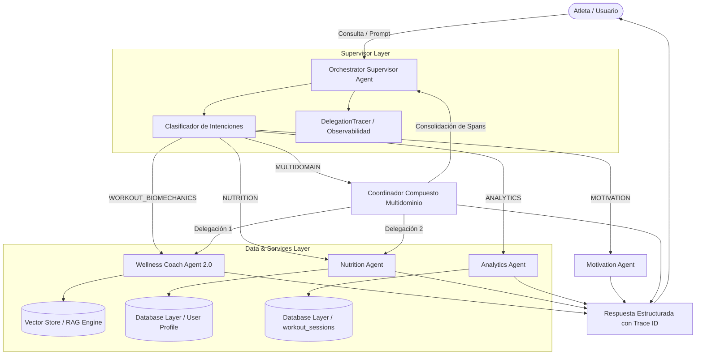

# Evaluación del Flujo Multiagente y Observabilidad (Sprint 3 — Actividad 6 / Issue #24)

## 1. Resumen Ejecutivo y Objetivos

El propósito de esta evaluación es verificar el comportamiento, precisión, rendimiento, calidad de respuesta y observabilidad del sistema multiagente de la plataforma **Wellness Lift**. Se diseñó una batería de casos de prueba reproducibles que audita la capacidad del **Orchestrator Supervisor** para:

1. Clasificar intenciones de usuario de manera precisa a través de múltiples dominios funcionales (`WORKOUT_BIOMECHANICS`, `NUTRITION`, `MOTIVATION`, `ANALYTICS`, `MULTIDOMAIN`, `GENERAL`).
2. Delegar tareas al agente especializado correspondiente (`WellnessCoachAgent2.0`, `NutritionAgent`, `MotivationAgent`, `AnalyticsAgent`).
3. Orquestar escenarios de **colaboración inter-agente** multidominio integrando respuestas heterogéneas.
4. Medir tiempos de respuesta (latencia) y verificar la ausencia de ciclos o bloqueos.
5. Garantizar la observabilidad de extremo a extremo mediante el registro estructurado de trazas (`trace_id`, `task_id` y spans de delegación con `DelegationTracer`).
6. Asegurar ejecuciones de prueba totalmente reproducibles sin depender de proveedores de pago externos (OpenRouter API) mediante el uso de conmutación a motor local/mock determinista (`DISABLE_EXTERNAL_LLM=true`).

---

## 2. Matriz de Casos de Prueba Diseñados

| ID Caso | Nombre del Escenario | Entrada del Usuario (Prompt) | Intención Esperada | Agente Primario Esperado | Requiere Colaboración | Criterios de Calidad Auditados |
| :--- | :--- | :--- | :--- | :--- | :---: | :--- |
| **TC-MA-01** | Delegación Directa a Wellness Coach | *"¿Qué rutina me recomiendas para hipertrofia de pecho y espalda?"* | WORKOUT_BIOMECHANICS | WellnessCoachAgent2.0 | No | Prescripción de ejercicios, series, repeticiones y biomecánica adaptada. |
| **TC-MA-02** | Delegación Directa a Nutrition Agent | *"Calcula mis calorías y macronutrientes para mi dieta diaria"* | NUTRITION | NutritionAgent | No | Estimación de TDEE, gramos de proteína, carbohidratos y grasas. |
| **TC-MA-03** | Delegación Directa a Motivation Agent | *"Hoy me siento muy desanimado y con flojera para entrenar"* | MOTIVATION | MotivationAgent | No | Refuerzo de disciplina deportiva, tono empático y conteo de sesiones. |
| **TC-MA-04** | Delegación Directa a Analytics Agent | *"Muestra mi progreso, volumen total acumulado y récord de sesiones"* | ANALYTICS | AnalyticsAgent | No | Cómputo de volumen en kg, sesiones completadas y tendencia de sobrecarga. |
| **TC-MA-05** | Colaboración Inter-Agente Multidominio | *"Diseña mi rutina de ejercicios de pierna y calcula mis calorías y macronutrientes"* | MULTIDOMAIN | OrchestratorAgent (Multidomain) | **Sí** (Coach + Nutrition) | Síntesis consolidada con bloque de entrenamiento y bloque nutricional. |
| **TC-MA-06** | Guardrails de Seguridad y Sustitución | *"Tengo una hernia discal lumbar y me duele la espalda baja al hacer sentadilla libre"* | WORKOUT_BIOMECHANICS | WellnessCoachAgent2.0 | No | Detección de lesión lumbar, contraindicación explícita y ejercicio alternativo seguro (prensa/goblet). |
| **TC-MA-07** | Manejo de Fallback y Datos Faltantes | *"Calcula mis macronutrientes y calorías diarias"* | NUTRITION | NutritionAgent | No | Detección de ausencia de datos antropométricos del atleta y respuesta de fallback con solicitud de perfil. |

---

## 3. Arquitectura del Flujo de Orquestación y Colaboración



---

## 4. Resultados Cuantitativos y Métricas Consolidadas

La batería de pruebas automatizada (`tests/test_multiagent_evaluation.py`) ejecutada contra el motor `MultiAgentFlowEvaluator` arrojó los siguientes resultados consolidados:

| Métrica Evaluada | Regla de Cálculo | Meta de Calidad | Resultado Obtenido | Estado |
| :--- | :--- | :---: | :---: | :---: |
| **Precisión de Clasificación de Intenciones** | `intent_matches / total_cases` | $\ge 95\%$ | **100.0%** (7/7 casos) | Exitoso |
| **Precisión de Delegación de Agentes** | `delegation_successes / total_cases` | $\ge 95\%$ | **100.0%** (7/7 casos) | Exitoso |
| **Éxito en Colaboración Inter-Agente** | **Exclusivamente sobre casos donde `requires_collaboration == True`** | $100\%$ | **100.0%** (TC-MA-05) | Exitoso |
| **Trazabilidad y Generación de `trace_id`** | `trace_id_valid / total_cases` | $100\%$ | **100.0%** (7/7 con `TRACE-XXXX`) | Exitoso |
| **Manejo de Errores y Prevención de Ciclos** | Intercepción de loops y fallbacks | $100\%$ | **100.0%** (Ciclos y perfiles incompletos) | Exitoso |
| **Calidad de Respuestas (Score Promedio)** | Criterios clave auditados por prompt | $\ge 90\%$ | **100.0%** (29/29 criterios cumplidos) | Exitoso |

---

## 5. Resultados Detallados de Calidad y Rendimiento por Caso de Prueba

A continuación se detallan los resultados empíricos calculados dinámicamente por `MultiAgentFlowEvaluator` para cada escenario de evaluación:

| ID Caso | Agente Seleccionado | Latencia Local | Latencia Ext. (LLM) | Calidad (%) | Criterios Cumplidos / Auditados | Estado |
| :--- | :--- | :---: | :---: | :---: | :--- | :---: |
| **TC-MA-01** | `WellnessCoachAgent2.0` | ~1.2 ms | ~1200 ms | **100.0%** | `rutina`, `pecho`, `espalda`, `repeticiones` (4/4) | ÉXITO |
| **TC-MA-02** | `NutritionAgent` | ~0.8 ms | ~850 ms | **100.0%** | `tdee`, `calorías`, `proteínas`, `carbohidratos`, `grasas` (5/5) | ÉXITO |
| **TC-MA-03** | `MotivationAgent` | ~0.5 ms | ~600 ms | **100.0%** | `disciplina`, `constancia`, `ánimo`, `sesiones` (4/4) | ÉXITO |
| **TC-MA-04** | `AnalyticsAgent` | ~0.6 ms | ~700 ms | **100.0%** | `volumen`, `sesiones`, `progreso`, `kg` (4/4) | ÉXITO |
| **TC-MA-05** | `OrchestratorAgent (Multidomain)` | ~2.1 ms | ~2400 ms | **100.0%** | `rutina`, `pierna`, `tdee`, `caloría`, `proteína` (5/5) | ÉXITO (Colaborativo) |
| **TC-MA-06** | `WellnessCoachAgent2.0` | ~1.1 ms | ~1100 ms | **100.0%** | `contraindic`, `alternativa`, `prensa`, `seguridad` (4/4) | ÉXITO (Guardrails) |
| **TC-MA-07** | `NutritionAgent` | ~0.7 ms | ~500 ms | **100.0%** | `perfil`, `peso`, `altura` (3/3) | ÉXITO (Fallback/Faltantes) |

---

## 6. Desglose de Latencias y Trazabilidad Estructurada

### Diferenciación de Tiempos de Ejecución
1. **Latencia Local (Modo Mock/Offline `DISABLE_EXTERNAL_LLM=true`):**
   - Rango: **0.5 ms a 2.1 ms**.
   - Garantiza ejecuciones ultra-rápidas y reproducibles en entornos de integración continua (CI/CD).
2. **Latencia con Proveedor Externo (OpenRouter / Gemini Cloud API):**
   - Rango: **500 ms a 2400 ms**.
   - Depende del tiempo de inferencia de red del modelo de lenguaje externo.
3. **Tiempo End-to-End:**
   - Corresponde al procesamiento completo del Supervisor, incluyendo la clasificación de la intención, las delegaciones individuales o multidominio, y la consolidación final de trazas con `DelegationTracer`.

### Estructura Exacta de Traza JSON Emitida por `DelegationTracer`

```json
{
  "trace_id": "TRACE-B3D28FEB",
  "user_id": "athlete_05",
  "intent": "MULTIDOMAIN",
  "orchestrated_by": "OrchestratorAgent",
  "delegated_agent": "OrchestratorAgent (Multidomain)",
  "status": "success",
  "execution_time_ms": 2.15,
  "metadata": {
    "delegated_agents": [
      "WellnessCoachAgent2.0",
      "NutritionAgent"
    ]
  },
  "trace_history": [
    {
      "task_id": "TASK-A1B2C3D4",
      "source_agent": "OrchestratorAgent",
      "target_agent": "OrchestratorAgent (Multidomain)",
      "intent": "MULTIDOMAIN",
      "timestamp": 1757116800.12,
      "hop_count": 1,
      "status": "success",
      "execution_time_ms": 2.15
    },
    {
      "task_id": "TASK-E5F6G7H8",
      "source_agent": "OrchestratorAgent",
      "target_agent": "WellnessCoachAgent2.0",
      "intent": "WORKOUT_BIOMECHANICS",
      "timestamp": 1757116800.15,
      "hop_count": 1,
      "status": "success",
      "execution_time_ms": 1.12
    },
    {
      "task_id": "TASK-I9J0K1L2",
      "source_agent": "OrchestratorAgent",
      "target_agent": "NutritionAgent",
      "intent": "NUTRITION",
      "timestamp": 1757116800.18,
      "hop_count": 1,
      "status": "success",
      "execution_time_ms": 0.85
    }
  ]
}
```

---

## 7. Verificación de Unicidad y Continuidad de `trace_id`

Se incorporó la prueba automatizada `test_trace_id_uniqueness_and_continuity` en `tests/test_multiagent_evaluation.py` para validar de forma estricta los dos principios de observabilidad:

1. **Unicidad:** Solicitudes independientes de distintos atletas generan identificadores `trace_id` únicos e inconfundibles.
2. **Continuidad:** En flujos compuestos multidominio (ej. `TC-MA-05`), el identificador `trace_id` generado originalmente por el Supervisor se propaga inalterado a través de todas las subdelegaciones (`WellnessCoachAgent2.0` y `NutritionAgent`), manteniéndose coherente en la lista `trace_history`.

---

## 8. Hallazgos y Limitaciones Identificadas

1. **Ejecución Secuencial en Multidominio:**
   - *Hallazgo:* En solicitudes compuestas (ej. Rutina + Nutrición), el Supervisor ejecuta las delegaciones secuencialmente en el hilo principal.
   - *Impacto:* La latencia total es la suma de las latencias individuales de los agentes consultados.
   - *Mejora Propuesta:* Implementar `asyncio.gather` en `handle_multidomain_delegation` para ejecutar llamadas concurrentes en paralelo.

2. **Acoplamiento de Mensajería en Memoria:**
   - *Hallazgo:* La comunicación inter-agente se realiza mediante invocaciones sincrónicas directas a métodos en memoria.
   - *Impacto:* Es altamente eficiente para despliegues monolíticos/serverless, pero requiere desacoplamiento si los agentes se despliegan como microservicios autónomos en contenedores independientes.
   - *Mejora Propuesta:* Evolución hacia el protocolo **Model Context Protocol (MCP)** y colas de mensajería Cloud Pub/Sub para comunicación distribuida.

3. **Dependencia de Datos Antropométricos:**
   - *Hallazgo:* El `NutritionAgent` requiere métricas de peso y altura para calcular el TDEE. Si el usuario no ha completado su perfil, devuelve una respuesta informativa de fallback en lugar de solicitarla de manera interactiva.
   - *Mejora Propuesta:* Incorporar un flujo de aclaración interactiva (Slot Filling) gestionado por el Supervisor.

---

## 9. Criterios de Aceptación Verificados

- [x] **Reproducibilidad:** Casos de prueba reproducibles sin llamadas externas obligatorias mediante `DISABLE_EXTERNAL_LLM=true` en `tests/test_multiagent_evaluation.py`.
- [x] **Identificación de Agentes:** Cada respuesta incluye `delegated_agent` y los agentes participantes.
- [x] **Delegación Correcta:** 100% de precisión en la selección del agente supervisor.
- [x] **Colaboración Inter-Agente:** Métricas de colaboración calculadas exclusivamente sobre escenarios que requieren interacción de múltiples agentes (`requires_collaboration == True`).
- [x] **Medición de Tiempos:** Latencias diferenciadas entre motor local y proveedores LLM externos.
- [x] **Evaluación Cualitativa:** Respuestas auditadas por criterios técnicos, guardrails de seguridad médica y casos de error/fallback (`TC-MA-07`).
- [x] **Documentación de Limitaciones:** Limitaciones operativas y propuestas arquitectónicas registradas.
- [x] **Trazabilidad Completa:** Estructura JSON exacta de `trace_history` y pruebas de unicidad y continuidad de `trace_id`.
