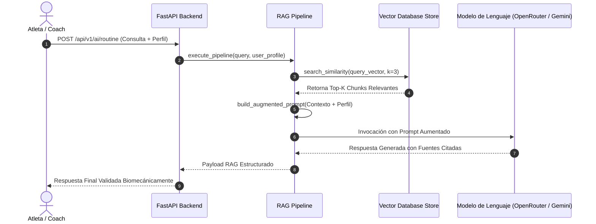

# ⚙️ Arquitectura del Pipeline RAG End-to-End — Wellness Lift (Issue #9)

## 1. Resumen Ejecutivo
Este documento describe el flujo completo, los componentes de software y los diagramas de secuencia del **Pipeline RAG End-to-End** implementado para la plataforma **Wellness Lift**, respondiendo al requerimiento **[S1-05 - Implementar pipeline RAG] (Issue #9)**.

---

## 2. Diagrama de Secuencia del Pipeline RAG



---

## 3. Etapas del Pipeline RAG (`src/backend/app/rag_pipeline.py`)

1. **Etapa 1: Ingesta y Vectorización de la Consulta**: Procesa la entrada del usuario y la convierte a vector ponderado TF-IDF L2.
2. **Etapa 2: Recuperación Semántica en Vector DB**: Consulta la base vectorial persistida (`data/vector_store/vector_index.json`) y extrae los 3 chunks con mayor coeficiente de similitud del coseno.
3. **Etapa 3: Aumento de Contexto (*Context Augmentation*)**: Inyecta el perfil de salud del atleta (ej. *Hernia Discal L4-L5*) y los fragmentos de conocimiento recuperados dentro de la estructura formal del prompt.
4. **Etapa 4: Inferencia y Generación LLM**: El motor del backend (`src/backend/app/agent.py`) genera la respuesta fundamentada estrictamente en la evidencia científica recuperada.
5. **Etapa 5: Citado de Fuentes y Respuesta Estructurada**: Retorna el texto generado citando los documentos fuente (`medical_adaptations.md`, `hypertrophy_periodization.md`, etc.).

---

## 4. Verificación Automatizada

La integración fue probada exitosamente con el script `scripts/test_rag_pipeline.py` y la suite de pruebas `tests/test_rag_pipeline.py`:
```bash
python -m unittest tests/test_rag_pipeline.py
# Ran 3 tests in 0.004s - OK
```
