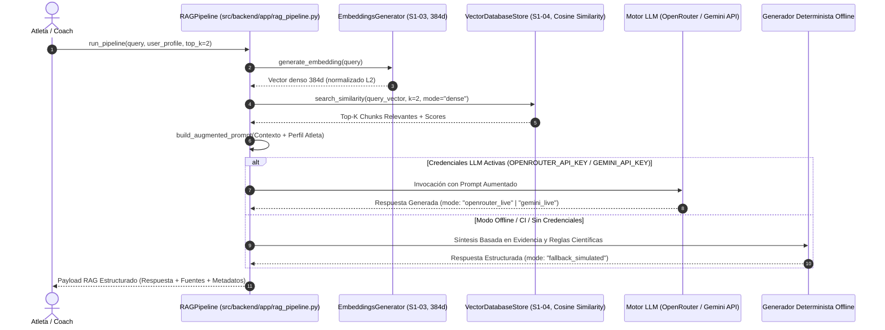

# ⚙️ Arquitectura del Pipeline RAG End-to-End — Wellness Lift (Issue #9)

## 1. Resumen Ejecutivo
Este documento describe el flujo completo, los componentes de software, la trazabilidad de la cadena consolidada **S1-03 $\rightarrow$ S1-04 $\rightarrow$ S1-05** y los mecanismos de generación (Live LLM vs. Fallback Determinista) del **Pipeline RAG End-to-End** implementado para la plataforma **Wellness Lift** ([Issue #9](https://github.com/YaskCode-laboratory/wellness-platform-team6/issues/9)).

---

## 2. Diagrama de Secuencia del Pipeline RAG



---

## 3. Etapas del Pipeline RAG (`src/backend/app/rag_pipeline.py`)

1. **Etapa 1: Ingesta y Vectorización de Consulta (S1-03)**:
   - Transforma la consulta en un vector denso de 384 dimensiones mediante `EmbeddingsGenerator` (`local-deterministic-hashing-384d`).
   - **Desacoplamiento estricto de credenciales**: La presencia de `GEMINI_API_KEY` o `OPENROUTER_API_KEY` en el entorno para la generación LLM no altera el modelo ni la dimensionalidad de los embeddings de consulta, garantizando compatibilidad 100% con el índice de 384d.
2. **Etapa 2: Recuperación Semántica en Vector DB (S1-04)**:
   - Consulta `VectorDatabaseStore` (`data/vector_store/vector_index.json`) calculando Similitud del Coseno entre el vector de consulta y los vectores de los chunks indexados.
   - **Validación Dimensional Estricta**: `VectorDatabaseStore.search_similarity()` valida explícitamente que `len(query_emb) == self.embedding_dim`, lanzando un `ValueError` descriptivo ante cualquier discrepancia dimensional.
3. **Etapa 3: Aumento de Contexto (*Context Augmentation*)**:
   - Inyecta el perfil de salud del atleta (ej. *Hernia Discal L4-L5*, nivel de entrenamiento) y los fragmentos científicos recuperados con sus fuentes bibliográficas dentro del prompt estructurado.
4. **Etapa 4: Inferencia y Generación**:
   - **Modo Producción (Live LLM)**: Si `OPENROUTER_API_KEY` o `GEMINI_API_KEY` están configuradas y disponibles, delega la inferencia al modelo externo (`openrouter_live` o `gemini_live`).
   - **Modo Fallback / Simulado Determinista (*Grounded Fallback*)**: Si no hay conexión o claves de API configuradas (ej. CI/CD), activa un generador determinista estructurado que sintetiza las respuestas extrayendo dinámicamente las directrices, tablas de contraindicación y reglas técnicas directamente de los `retrieved_chunks` recuperados (`fallback_simulated`).
5. **Etapa 5: Payload Trazable y Citado de Fuentes**: Retorna un objeto estructurado que incluye:
   - `retrieved_chunks`: Lista de chunks con scores de similitud y metadatos de embeddings.
   - `sources`: Archivos fuente citados (`medical_adaptations.md`, `biomechanics_and_safety.md`, etc.).
   - `generation_mode`: Indicador explícito del modo (`openrouter_live`, `gemini_live` o `fallback_simulated`).
   - `rag_response`: Texto final fundamentado de la recomendación biomecánica.

---

## 4. Pruebas de Ejecución End-to-End

Resultados obtenidos mediante el script reproducible `scripts/test_rag_pipeline.py`:

| Caso de Prueba | Consulta | Fuentes Citadas | Modo de Generación |
|---|---|---|---|
| **Hernia Discal L4-L5** | *¿Qué ejercicios debo reemplazar si sufro de una hernia discal lumbar L4-L5?* | `medical_adaptations.md`, `hypertrophy_periodization.md` | `fallback_simulated` / `live` |
| **Sobrecarga Progresiva** | *¿Cuáles son las reglas de sobrecarga progresiva para maximizar la hipertrofia?* | `biomechanics_and_safety.md` | `fallback_simulated` / `live` |
| **Valgo de Rodilla** | *Alineación articular y prevención de valgo de rodilla en sentadilla* | `biomechanics_and_safety.md`, `medical_adaptations.md` | `fallback_simulated` / `live` |

---

## 5. Verificación Automatizada

La suite de pruebas en `tests/test_rag_pipeline.py` valida:
1. `test_context_retrieval_dense_384d`: Recuperación semántica consumiendo los embeddings densos de 384d.
2. `test_context_retrieval_tfidf_mode`: Recuperación mediante baseline TF-IDF.
3. `test_augmented_prompt_construction`: Construcción del prompt aumentado con perfil y fuentes.
4. `test_full_pipeline_execution_metadata`: Trazabilidad completa de metadatos y modo de generación.
5. `test_lumbar_contraindications_synthesis`: Validación de sustituciones para patologías lumbares.
6. `test_hypertrophy_principles_synthesis`: Validación de principios de hipertrofia y sobrecarga.
7. `test_grounded_fallback_custom_chunks`: Validación de grounding dinámico en chunks personalizados inyectados.
8. `test_incompatible_embedding_dimension_error`: Validación de error explícito ante discrepancias dimensionales.

```bash
python -m unittest tests/test_rag_pipeline.py
# Ran 8 tests in 0.015s - OK
```

