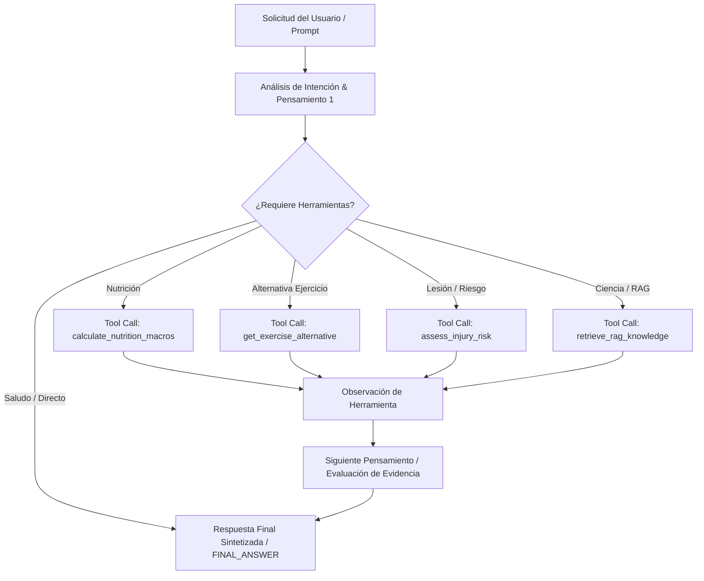

# Arquitectura del Patrón ReAct y Flujo de Razonamiento — Wellness Coach Agent 2.0 (Issue #16)

## 1. Resumen Ejecutivo
Este documento describe el diseño, la integración con el registro unificado de herramientas `AgentToolRegistry` y la implementación del flujo de razonamiento basado en el patrón **ReAct (Reasoning + Acting)** para el **Wellness Coach Agent 2.0**, respondiendo al requerimiento **[S2-05 - Implementar patrón ReAct y flujo de razonamiento] (Issue #16)**.

---

## 2. Ciclo de Razonamiento ReAct (`Thought -> Action -> Observation -> Final Answer`)

El flujo ReAct se ejecuta de forma dinámica e intencionada dentro del flujo principal del agente (`WellnessCoachAgent.generate_response`). Los pensamientos y la selección de acciones son generados según el análisis de intenciones del prompt y las observaciones de pasos previos:



---

## 3. Registro Unificado de Herramientas (`AgentToolRegistry`)

El agente ReAct reutiliza directamente la arquitectura de herramientas de S2-04 expuesta en `src/backend/app/wellness_agent/tools.py`:

| Nombre de Herramienta | Firma y Entradas | Propósito y Salida |
| :--- | :--- | :--- |
| `get_exercise_alternative` | `muscle_group: str` | Retorna un ejercicio sustituto seguro para el mismo grupo muscular. |
| `calculate_nutrition_macros` | `user_id: str` | Calcula el TDEE y desglose de macronutrientes recomendados. |
| `assess_injury_risk` | `user_id, exercise_name` | Evalúa el riesgo biomecánico según las condiciones de salud del atleta. |
| `retrieve_rag_knowledge` | `query_text: str, top_k=2` | Búsqueda semántica vectorial en la base de conocimiento RAG. |

---

## 4. Control de Bucles e Historial (*Anti-Loop Protection*)

Para prevenir ciclos infinitos o re-invocaciones duplicadas:
1. **Límite Estricto de Iteraciones**: Restringido a un máximo de 5 iteraciones (`max_iterations = 5`).
2. **Detección de Firmas de Acción**: Se calcula la firma `action_name:json.dumps(action_input)`. Si el agente intenta invocar la misma herramienta con los mismos argumentos por segunda vez, se detecta el ciclo duplicado (`loop_detected = True`), se fuerza la acción `FINAL_ANSWER` y se interrumpe la iteración.

---

## 5. Verificación Automatizada

La suite de pruebas en `tests/test_react_agent.py` valida la selección dinámica de herramientas, la integración con `AgentToolRegistry`, la prueba end-to-end sobre el flujo principal y la detección explícita de bucles:
```bash
pytest tests/test_react_agent.py -v
# 5 passed in 1.48s
```
