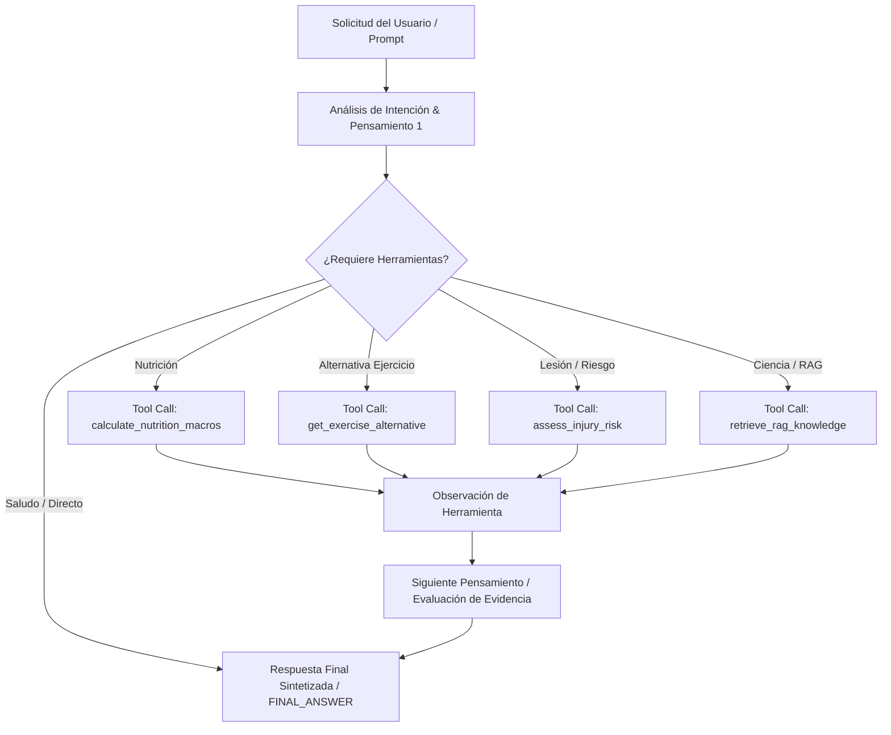

# Arquitectura del Patrón ReAct y Flujo de Razonamiento — Wellness Coach Agent 2.0 (Issue #16 & Issue #18)

## 1. Resumen Ejecutivo
Este documento describe el diseño, la integración con el registro unificado de herramientas `AgentToolRegistry` y la implementación del flujo de razonamiento basado en el patrón **ReAct (Reasoning + Acting)** para el **Wellness Coach Agent 2.0**, respondiendo al requerimiento **[S2-05 - Implementar patrón ReAct y flujo de razonamiento] (Issue #16)** y consolidado en el **[S2-07 - Documentación Maestra del Agente] (Issue #18)**.

---

## 2. Ciclo de Razonamiento ReAct (`Thought -> Action -> Observation -> Final Answer`)

El flujo ReAct se ejecuta de forma dinámica e intencionada dentro del flujo principal del agente (`WellnessCoachAgent.generate_response`). Los pensamientos (*Thoughts*) y la selección de acciones (*Actions*) son generados mediante el análisis de intenciones del mensaje de entrada del usuario, el historial conversacional (`ConversationMemoryManager`) y las observaciones de pasos previos:



---

## 3. Registro Unificado de Herramientas (`AgentToolRegistry`)

El agente ReAct reutiliza directamente la arquitectura de herramientas expuesta en `src/backend/app/wellness_agent/tools.py`:

| Nombre de Herramienta | Firma y Entradas | Propósito y Salida |
| :--- | :--- | :--- |
| `get_exercise_alternative` | `muscle_group: str` | Retorna un ejercicio sustituto del catálogo para el grupo muscular especificado. |
| `calculate_nutrition_macros` | `user_id: str` | Calcula el TDEE y desglose de macronutrientes recomendados. |
| `assess_injury_risk` | `user_id, exercise_name` | Evalúa el riesgo biomecánico según las condiciones de salud y memoria del atleta. |
| `retrieve_rag_knowledge` | `query_text: str, top_k=2` | Búsqueda semántica vectorial en la base de conocimiento RAG. |

---

## 4. Integración con el Flujo Principal del Agente

El ciclo ReAct está integrado directamente en la fachada pública `WellnessCoachAgent.generate_response()` en `src/backend/app/agent.py`:

```python
# Flujo ReAct en WellnessCoachAgent.generate_response()
react_result = self.react.run_react_loop(message, athlete_id=user_id)
response_text = react_result["final_answer"]
self.memory.add_message(user_id, "assistant", response_text)
```

1. **Recepción del Mensaje**: Se registra la entrada del usuario en `ConversationMemoryManager`.
2. **Ciclo ReAct**: `ReActAgent.run_react_loop` ejecuta la secuencia `Thought -> Action -> Observation -> nueva decisión -> Final Answer`.
3. **Síntesis y Persistencia**: La respuesta final sintetizada se guarda en la memoria episódica del usuario.

---

## 5. Control de Bucles e Historial (*Anti-Loop Protection*)

Para prevenir ciclos infinitos o re-invocaciones redundantes:
1. **Límite Estricto de Iteraciones**: Restringido a un máximo de 5 iteraciones (`max_iterations = 5`).
2. **Detección de Firmas de Acción**: Se calcula la firma `action_name:json.dumps(action_input)`. Si el agente intenta invocar la misma herramienta con los mismos argumentos por segunda vez, se detecta la duplicación (`loop_detected = True`), se fuerza la acción `FINAL_ANSWER` y se interrumpe la iteración.

---

## 6. Verificación Automatizada

La suite de pruebas en `tests/test_react_agent.py` valida la selección dinámica de herramientas, la integración con `AgentToolRegistry`, la prueba end-to-end sobre el flujo principal y la detección explícita de bucles:

```bash
pytest tests/test_react_agent.py -v
```
