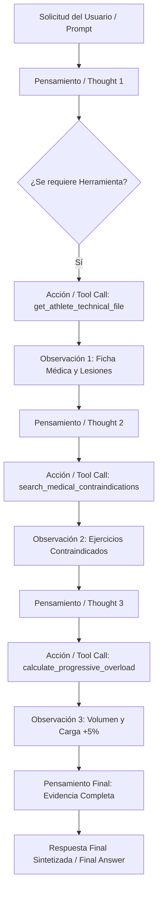

# 🧠 Arquitectura del Patrón ReAct y Flujo de Razonamiento — Wellness Coach Agent 2.0 (Issue #16)

## 1. Resumen Ejecutivo
Este documento describe el diseño, la integración de herramientas y la implementación del flujo de razonamiento basado en el patrón **ReAct (Reasoning + Acting)** para el **Wellness Coach Agent 2.0**, respondiendo al requerimiento **[S2-05 - Implementar patrón ReAct y flujo de razonamiento] (Issue #16)**.

---

## 2. Ciclo de Razonamiento ReAct (`Thought -> Action -> Observation -> Final Answer`)



---

## 3. Registro de Herramientas (*Tool Registry*)

El agente ReAct integra 4 herramientas especializadas en `src/backend/app/react_agent.py`:

| Nombre de Herramienta | Firma y Entradas | Propósito y Salida |
| :--- | :--- | :--- |
| `get_athlete_technical_file` | `athlete_id: str` | Consulta expediente deportivo, lesiones activas y rutina previa. |
| `search_medical_contraindications` | `condition: str` | Retorna lista de ejercicios prohibidos y sustitutos biomecánicos. |
| `query_rag_vector_store` | `query: str` | Recupera evidencia de la base de conocimiento vectorial. |
| `calculate_progressive_overload` | `sets, reps, weight_kg` | Calcula el volumen total ($Volumen = Series \times Reps \times Carga$) y sugiere incremento del +5%. |

---

## 4. Control de Bucles e Historial (*Anti-Loop Protection*)

Para evitar ciclos infinitos o re-invocaciones innecesarias de herramientas:
1. **Límite Estricto de Iteraciones**: El bucle está restringido a un máximo de 5 iteraciones (`max_iterations = 5`).
2. **Detección de Firmas de Acción**: Se registra una firma hash `action_name:action_input`. Si el agente intenta invocar la misma herramienta con los mismos parámetros por segunda vez, el ciclo se interrumpe y se fuerza la síntesis en `FINAL_ANSWER`.

---

## 5. Verificación Automatizada

La suite de pruebas en `tests/test_react_agent.py` y el script `scripts/test_react_agent.py` validan el flujo completo:
```bash
python -m unittest tests/test_react_agent.py
# Ran 3 tests in 0.003s - OK
```
