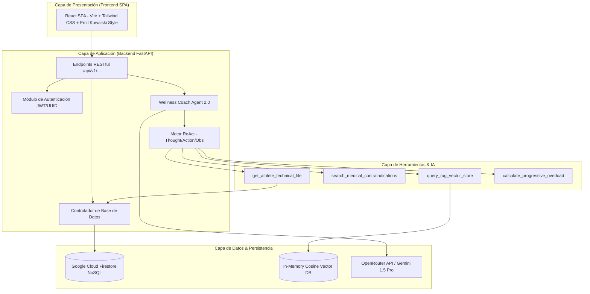

# 🏛️ Arquitectura del Sistema — Wellness Lift

## 1. Visión General
La arquitectura de **Wellness Lift** está diseñada bajo el patrón de microservicios desarticulados, combinando una aplicación web de página única (SPA React) con un backend asíncrono en FastAPI y un motor conversacional dotado de RAG y razonamiento ReAct.

---

## 2. Diagrama de Componentes (Mermaid)

---

## 3. Capas Principales del Sistema

1. **Frontend SPA (React 19 + Vite 8)**:
   - Diseño moderno basado en componentes modulares.
   - Soporte para cambio de roles (Atleta, Coach, Administrador) y chat conversacional interactivo.
2. **Backend RESTful (FastAPI 0.110)**:
   - Enrutamiento optimizado, validación de schemas con Pydantic y CORS abierto para consumo seguro.
3. **Capa de Persistencia Híbrida**:
   - Soporte dual: Almacenamiento NoSQL en **Google Cloud Firestore** con fallback automático a **Mock Database Memory Store** para ejecuciones locales sin dependencias externas.
