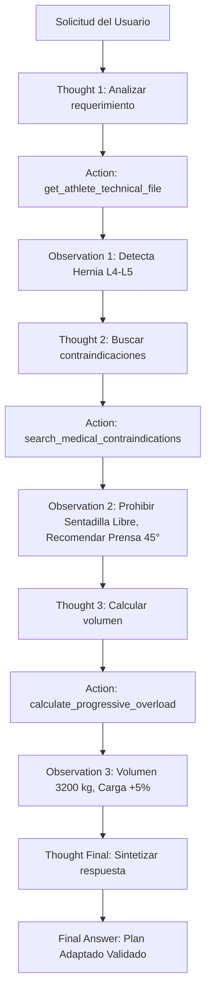

# 🧠 Wellness Coach Agent 2.0 — Patrón ReAct

## 1. Ciclo de Razonamiento ReAct (`Thought -> Action -> Observation -> Final Answer`)
El **Wellness Coach Agent 2.0** (`src/backend/app/react_agent.py`) combina razonamiento reflexivo, llamadas a herramientas y observaciones empíricas antes de generar una prescripción deportiva:

---

## 2. Registro de Herramientas (*Tool Registry*)
1. `get_athlete_technical_file`: Consulta expediente de salud y rutina actual.
2. `search_medical_contraindications`: Retorna ejercicios prohibidos y sustitutos biomecánicos.
3. `query_rag_vector_store`: Recupera evidencia científica de la base vectorial.
4. `calculate_progressive_overload`: Calcula volumen total ($V = S \times R \times C$) y sugiere sobrecarga progresiva (+5%).

---

## 3. Protección Anti-Bucles Infinitos
- Restricción a un máximo de **5 iteraciones** (`max_iterations = 5`).
- Firma Hash de Llamada (`action_name:action_input`). Si se detecta invocación idéntica, fuerza la síntesis inmediata en `FINAL_ANSWER`.

---

## 4. Benchmark de Evaluación de Calidad
- **Total Casos Evaluados**: 5
- **Tasa de Éxito (*Accuracy*)**: `100.0%`
- **Puntaje de Relevancia**: `5.0 / 5.0`
- **Bucles Infinitos Detectados**: 0
